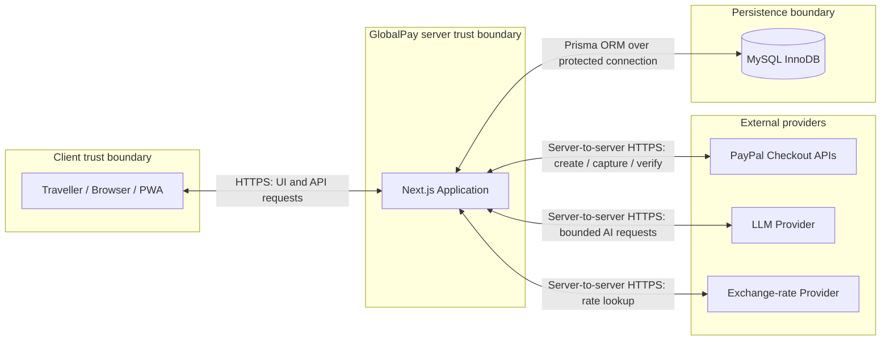
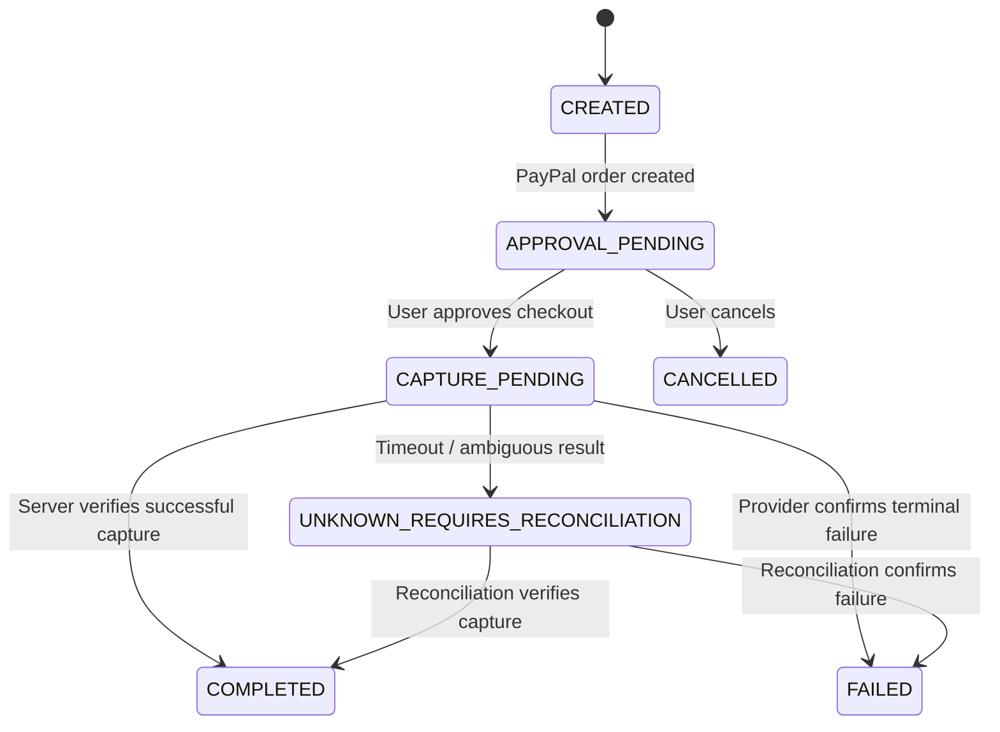

# GlobalPay — System Architecture

**Document version:** 1.0  
**Status:** Implementation blueprint for the MVP  
**Product:** GlobalPay — AI-assisted international travel payment PWA  
**Hackathon:** PayPal AI Hackathon 2026  
**Source of truth:** `GlobalPay_PRD_v1.2_MySQL_Prisma_Security_Hardened.md`

> GlobalPay is a hackathon prototype. PayPal Sandbox is used for test payments. The MVP does not process real-money international payments, hold funds, or provide universal QR-payment interoperability.

---

## 1. Architectural goals

1. Deliver a polished, mobile-first Progressive Web App.
2. Keep payment authority and secrets on the server.
3. Use **MySQL (InnoDB) + Prisma ORM** for persistent application records.
4. Verify PayPal payment state server-side before persisting a completed transaction.
5. Make currency calculations deterministic and clearly label estimates.
6. Restrict the AI assistant to explanatory, read-only capabilities.
7. Keep the implementation small enough for a solo hackathon developer while preserving clear module boundaries.
8. Make failure, retry, timeout, and reconciliation paths explicit.

## 2. Technology decisions

| Layer | Decision | Responsibility |
|---|---|---|
| Web application | Next.js + React + TypeScript | Pages, components, route handling, server rendering |
| Styling and UI | Tailwind CSS + Aceternity UI, selectively | Design system and visual components |
| Animation | Motion for React | Transitions and interaction feedback; respect reduced-motion settings |
| PWA | Web app manifest + service worker | Installability and selected static-asset caching |
| Server/API | Next.js Route Handlers | Validate requests, enforce permissions, orchestrate providers |
| Input validation | Zod or equivalent schema validator | Validate request bodies, route parameters, QR payloads, and tool arguments |
| Database | MySQL using InnoDB | Persistent merchant fixtures and transaction records |
| Database access | Prisma ORM | Typed queries, schema, migrations, and database transactions |
| Payment provider | PayPal JavaScript SDK + Checkout APIs | User-approved PayPal Sandbox checkout |
| AI | Server-side LLM API with structured tool calls | Explain supported options and application data |
| Currency data | Documented exchange-rate API/provider | Indicative exchange rates with timestamps |
| Hosting | HTTPS-capable deployment, e.g. Vercel | Deploy web application and server-side routes |

**Database decision is fixed:** use MySQL (InnoDB) with Prisma. Do not substitute PostgreSQL in implementation instructions or setup documentation.

## 3. System context and trust boundaries



### Trust-boundary rules

- Treat the browser, browser storage, QR contents, user prompts, and all client-submitted fields as untrusted.
- The Next.js server is responsible for validation, authorization, payment orchestration, calculations, and transaction-state changes.
- MySQL stores GlobalPay's application records; it is not the authority for whether PayPal captured a payment.
- PayPal is the external authority for the PayPal order/capture state. Verify provider responses before recording `COMPLETED`.
- AI output is untrusted explanatory text. It cannot authorize payments, decide authoritative totals, or mutate payment state.
- Currency-rate responses are external data. Validate their shape and timestamps and handle unavailable or stale rates explicitly.
- Secrets must remain in server-side environment variables and must never be included in client bundles or public API responses.

## 4. High-level application structure

```text
globalpay/
├── app/
│   ├── (pages)/
│   │   ├── page.tsx                    # Home / dashboard
│   │   ├── merchant/[merchantId]/      # Merchant and price review
│   │   ├── assistant/                  # AI payment assistant
│   │   ├── checkout/[transactionId]/   # Checkout review and PayPal UI
│   │   ├── receipt/[transactionId]/    # Verified sandbox receipt
│   │   └── transactions/               # Transaction history
│   ├── api/
│   │   ├── merchants/                  # Supported merchant scenarios
│   │   ├── currency/                   # Indicative rate lookup
│   │   ├── transactions/               # Create/read transaction records
│   │   ├── payments/paypal/create/     # Server-side order creation
│   │   ├── payments/paypal/capture/    # Server-side capture and verification
│   │   └── assistant/                  # AI orchestration and tool routing
│   ├── layout.tsx
│   └── manifest.ts                     # Or use a static public manifest
├── components/
│   ├── ui/                             # Reusable design-system components
│   ├── navigation/
│   ├── currency/
│   ├── merchant/
│   ├── checkout/
│   ├── assistant/
│   └── transactions/
├── lib/
│   ├── validation/                     # Zod schemas
│   ├── auth/                           # Session and transaction-access checks
│   ├── db.ts                           # Server-only Prisma client
│   ├── paypal/                         # Server-only PayPal client and verification
│   ├── currency/                       # Rate provider and decimal-safe calculations
│   ├── payments/                       # State machine, idempotency, reconciliation
│   ├── ai/                             # LLM client, prompts, tool definitions
│   ├── qr/                             # Supported demo QR parser/schema
│   ├── rate-limit/                     # Endpoint-specific rate limiting
│   └── logging/                        # Redaction and safe structured logging
├── prisma/
│   ├── schema.prisma
│   └── migrations/
├── public/
│   ├── icons/
│   └── ...                             # Static assets
├── docs/
│   ├── architecture.md
│   ├── threat-model.md
│   ├── api-contract.md
│   ├── payment-state-machine.md
│   ├── environment-variables.md
│   ├── database-schema.md
│   ├── security-test-plan.md
│   └── ai-guardrails.md
├── .env.example
└── README.md
```

This is a recommended logical structure, not a requirement to create every folder before implementation. Keep provider clients, database access, and secrets in server-only modules. Do not import server-only modules into client components.

## 5. Core modules and responsibilities

### 5.1 Presentation layer

Responsibilities:
- Render responsive PWA screens and accessible controls.
- Let travellers select home currency and destination.
- Display supported demo merchants, local price, indicative conversion, timestamp, known fees, and available demo payment methods.
- Collect explicit confirmation before checkout.
- Display pending, failed, cancelled, and verified-completed states distinctly.
- Show clear Sandbox/test-payment labels.

Rules:
- Never calculate authoritative payment totals in UI code.
- Never send a client-selected amount as the source of truth for a PayPal order.
- Never let a client set transaction status.
- Do not show a success animation or completed receipt until the server returns a verified result.
- Treat all displayed AI responses as explanatory content, not payment evidence.

### 5.2 API / server layer

Responsibilities:
- Validate every request at the server boundary.
- Enforce transaction access checks and rate limits.
- Resolve merchant and price details from trusted configuration/database records.
- Orchestrate PayPal, AI, and currency-provider calls.
- Enforce legal payment-state transitions.
- Use idempotency and safe concurrency controls.
- Return bounded, generic client errors while recording redacted diagnostic logs.

Next.js Route Handlers and Server Actions must be treated as externally reachable endpoints. Each sensitive operation must validate input and perform authorization checks independently.

### 5.3 Payment service

Responsibilities:
- Create a local transaction before or as part of initiating checkout.
- Resolve trusted merchant amount/currency server-side.
- Create PayPal orders using server-only credentials.
- Capture or verify orders through the server-side integration.
- Confirm the expected PayPal order, capture status, amount, and currency.
- Store provider identifiers and state changes safely.
- Handle duplicate requests, timeouts, retries, and ambiguous outcomes.
- Reconcile ambiguous provider outcomes before retrying capture or showing a final result.

The payment service must not accept AI output or a browser callback as proof of payment.

### 5.4 Currency service

Responsibilities:
- Retrieve rates from a documented provider.
- Validate currency codes, response structure, rate value, and timestamp.
- Calculate indicative converted amounts using decimal-safe arithmetic and documented rounding rules.
- Label rates as indicative and show when they were retrieved.
- Clearly distinguish estimates from the amount confirmed by PayPal.
- Handle unavailable or stale data without inventing a rate or a zero fee.

Currency conversion is deterministic application logic, not an LLM responsibility.

### 5.5 AI assistant service

Permitted tools should be narrowly scoped and read-only, for example:
- `explain_conversion`: explain a conversion using server-provided rate and amount data.
- `list_supported_payment_options`: return configured options for a known demo merchant.
- `get_transaction_status`: return a permitted transaction's actual application status.
- `explain_payment_error`: map a known error category to approved guidance.

Controls:
- Validate every tool argument on the server.
- Enforce access checks within each tool.
- Pass only the minimum context required.
- Bound request size, response size, execution time, and provider retries.
- Rate-limit assistant requests.
- Treat prompts and retrieved content as untrusted data.
- Do not expose arbitrary SQL, arbitrary URL fetching, payment creation, capture, refund, or state-mutation tools.
- Do not let model output decide exchange rates, fees, payment totals, payment status, or authorization.

### 5.6 QR / merchant service

Responsibilities:
- Support only the documented `qr_demo_<country-code>_<merchant-key>_<two-digit-sequence>` identifier format.
- Resolve identifiers to active seeded demo merchants through the merchant catalogue API.
- Resolve merchant name, country, currency, and payment options from trusted server-side records.
- Reject unsupported or malformed payloads safely.
- Never automatically open QR-embedded URLs or fetch arbitrary URLs from the server.
- Hand off to `/pay?merchantId=...`; transaction creation remains in the existing payment-review flow.
- Keep QR selection simulated until camera scanning is implemented.

### 5.7 Persistence service

Responsibilities:
- Provide server-only access through Prisma.
- Apply version-controlled migrations.
- Enforce primary keys, foreign keys, unique constraints, indexes, and required fields.
- Use MySQL InnoDB transactions for related database writes.
- Persist monetary values using fixed-precision decimal representations.
- Avoid storing card details, PayPal access tokens, API secrets, or unnecessary personal data.
- Redact sensitive values from logs.

A database transaction can make related MySQL writes atomic. It cannot make an external PayPal API call atomic with MySQL. Provider/database partial failure requires explicit recovery and reconciliation.

## 6. Principal data model

The detailed Prisma schema belongs in `prisma/schema.prisma`; this section describes the logical entities.

### Merchant

| Field | Purpose |
|---|---|
| `id` | Stable internal merchant identifier |
| `name` | Display name |
| `country_code` | Merchant country |
| `currency_code` | Merchant's local currency |
| `demo_qr_identifier` | Identifier for a supported demo QR, if applicable |
| `supported_payment_methods` | Configured demo options; use a structured representation |

Merchant pricing and payment availability must come from trusted server-side configuration, not untrusted QR fields.

### Transaction

| Field | Purpose |
|---|---|
| `id` | Internal transaction identifier |
| `merchant_id` | Foreign key to merchant |
| `local_amount` | Purchase amount in merchant currency, fixed precision |
| `local_currency` | Merchant currency code |
| `home_currency` | Traveller's selected home currency |
| `indicative_exchange_rate` | Rate used for estimate, fixed precision as appropriate |
| `estimated_home_amount` | Indicative converted amount, fixed precision |
| `fee_breakdown` | Known fee details; use a validated structured representation |
| `paypal_order_id` | Verified provider order reference; unique where appropriate |
| `paypal_capture_id` | Verified capture reference; unique when present |
| `idempotency_key` | Operation-scoped idempotency key with appropriate uniqueness |
| `status` | Server-controlled state |
| `created_at` / `updated_at` | Audit and lifecycle timestamps |

Recommended additional implementation fields, if needed, include a provider status snapshot or reconciliation timestamp. Do not persist access tokens or credentials.

### User preferences / demo ownership

The PRD permits local preferences without mandatory account registration. If the MVP remains anonymous, define a secure server-side mechanism for scoping transaction reads to the browser's demo session before implementing history or receipt endpoints. Do not rely on a guessable transaction ID as authorization. If accounts are added later, define authentication, authorization, retention, and account data handling before persisting user-linked history.

## 7. Payment state machine

Use server-enforced states from the PRD:

- `CREATED`
- `APPROVAL_PENDING`
- `CAPTURE_PENDING`
- `COMPLETED`
- `CANCELLED`
- `FAILED`
- `UNKNOWN_REQUIRES_RECONCILIATION`

Example happy path:



Rules:
- Only server-side payment logic may change transaction state.
- `COMPLETED` requires verified successful capture and matching expected order, amount, and currency.
- Browser callbacks and redirect parameters are hints to continue the flow, not proof.
- A timeout or ambiguous capture must not be blindly retried. Reconcile with PayPal first.
- Repeated and concurrent requests must not create duplicate completed transactions.
- Persist a verified status update and its related history/audit record in a single MySQL transaction where possible.
- If PayPal succeeds but the database update fails, retain enough operation context to reconcile safely and retry the database update without recapturing blindly.

## 8. Key request and data flows

### 8.1 Merchant selection and conversion

1. Browser requests supported merchants or selects a merchant identifier.
2. Server validates the identifier and retrieves trusted merchant configuration.
3. Currency service retrieves or uses a valid cached rate.
4. Server calculates the indicative amount using decimal-safe logic.
5. UI displays local amount, home-currency estimate, rate timestamp, known fees, and the estimate disclaimer.

The client cannot override the merchant's trusted price or currency by editing a request.

### 8.2 PayPal Sandbox checkout

1. Browser requests checkout for an internal transaction identifier.
2. Server checks session/ownership and transaction state.
3. Server reloads trusted merchant amount and currency.
4. Server creates a PayPal order using server-only credentials and a suitable idempotency strategy.
5. Server stores the provider order reference and moves the transaction to the appropriate pending state.
6. Browser uses the PayPal-controlled approval flow.
7. Browser asks the server to continue/capture using the internal transaction/order reference; the server does not trust a client-supplied success status.
8. Server captures or verifies with PayPal.
9. Server checks provider result, expected order, amount, currency, and capture status.
10. Server writes the verified result and related history record using a MySQL transaction.
11. UI displays the result returned by the server. Only a verified result can produce a completed receipt.

If the provider result is ambiguous, mark the operation for reconciliation and show a pending/unknown message rather than a false success or an unsafe retry.

### 8.3 AI assistant request

1. Browser submits a bounded question and permitted context identifiers.
2. Server validates and rate-limits the request.
3. Server loads only the application data needed for the question.
4. LLM receives a constrained prompt and approved read-only tools.
5. Each tool independently validates inputs and permissions.
6. Server bounds and validates the response before returning it.
7. UI presents the answer as explanatory guidance.

The model never receives provider secrets and never receives tools that create/capture/refund payments or mutate transaction state.

### 8.4 QR selection

1. Browser scans or receives a QR payload.
2. Client passes the raw payload to the server only if needed for parsing; payload size is bounded.
3. Server validates the supported schema and extracts only the merchant identifier.
4. Server resolves the merchant and pricing from trusted records.
5. Unsupported or malformed data is rejected.
6. UI shows a merchant confirmation screen before checkout.

## 9. API boundary proposal

These are logical endpoint responsibilities, not a final API contract. Exact request/response schemas and status codes must be specified in `docs/api-contract.md`.

| Endpoint family | Responsibility | Key controls |
|---|---|---|
| `GET /api/merchants` | List supported demo merchants | Return only configured fields |
| `GET /api/merchants/:id` | Retrieve a configured merchant | Validate ID; no client-controlled price authority |
| `POST /api/currency/quote` | Obtain indicative conversion | Validate currency codes; timestamp and stale-data handling; rate limits |
| `POST /api/transactions` | Create a local transaction for a selected merchant | Validate request; derive price/currency server-side; scope to session |
| `GET /api/transactions` | List permitted session transactions | Enforce ownership/access checks |
| `GET /api/transactions/:id` | Retrieve a permitted transaction/receipt | Authorization check on every request |
| `POST /api/payments/paypal/create` | Create PayPal order | Trusted amount/currency; idempotency; rate limits |
| `POST /api/payments/paypal/capture` | Capture/verify approved order | Server-side verification; state validation; idempotency; safe reconciliation |
| `POST /api/assistant` | Ask the AI assistant | Input/output bounds; rate limits; tool allowlist; access checks |

Do not implement these as unauthenticated public operations merely because the app has no account system. Select and document a session/ownership strategy before exposing transaction creation, history, or receipt routes.

## 10. Security architecture requirements

### Secrets and configuration

- Keep `DATABASE_URL`, PayPal client secret, AI provider key, session secret, and any other private credentials server-side.
- Treat every `NEXT_PUBLIC_*` variable as public.
- Commit `.env.example` with placeholders only; never commit real `.env*` files.
- Separate development and PayPal Sandbox configuration from any future production configuration.
- Review Git history and rotate any secret that was exposed.

### Database and money

- MySQL InnoDB; Prisma schema and migrations committed to version control.
- Use fixed-precision `DECIMAL` / Prisma `Decimal` for persisted monetary amounts.
- Avoid JavaScript floating-point arithmetic for authoritative financial calculations; document rounding rules.
- Use unique constraints for applicable provider identifiers and idempotency keys.
- Use foreign keys and indexes for relationship integrity and common lookups.
- Use a dedicated least-privilege database account and protected connections where supported.
- Use Prisma's safe query APIs or parameterized SQL; never interpolate untrusted input into SQL.
- Do not log connection strings, credentials, full payment payloads, or unnecessary personal data.

### API and session security

- Validate body size, data types, formats, and allowed values.
- Apply authorization at every sensitive endpoint and inside every AI tool.
- Use suitable CSRF/origin protections for the chosen session and mutation model.
- Restrict CORS to required origins if cross-origin access is necessary; CORS is not authorization.
- Apply rate limits, timeouts, bounded retries, and output limits.
- Return generic public errors; log redacted diagnostic context.
- Use safe React rendering and do not inject untrusted HTML.
- Treat QR content and external-provider responses as untrusted.

### Payment and AI invariants

- No client value or AI output can mark a transaction completed.
- The server derives amount/currency from trusted merchant data.
- Verify provider order, capture, amount, currency, and successful status before completion.
- Keep the AI tool allowlist read-only and narrowly scoped.
- Fail closed on mismatches, invalid states, unknown merchant IDs, or failed verification.
- Clearly label all sandbox transactions and receipts as tests.

## 11. Reliability and failure handling

| Failure | Required behavior |
|---|---|
| Currency provider unavailable | Show an unavailable/stale-rate state; do not invent a rate |
| AI provider unavailable | Show a graceful fallback and preserve core payment flow |
| PayPal order creation fails | Do not present a usable checkout as created; return a safe error |
| User cancels PayPal approval | Mark/record cancellation only through a valid server-side transition |
| PayPal capture returns a confirmed failure | Record the appropriate failure state |
| PayPal capture times out or result is ambiguous | Set reconciliation-required state; query provider before retrying |
| PayPal capture succeeds but MySQL update fails | Do not recapture blindly; reconcile provider state and retry persistence safely |
| Duplicate or concurrent request | Use idempotency, state checks, and database uniqueness to avoid duplicate effects |
| Malformed QR payload | Reject safely and offer manual merchant selection |
| AI produces unsupported claim | Do not use it as authoritative data; constrain output and fall back where possible |
| Database unavailable | Fail safely; never claim a payment is complete without a persisted, verified application result |

## 12. Observability and privacy

- Log request correlation IDs, internal transaction IDs, state transitions, and provider error categories where useful.
- Redact credentials, access tokens, connection strings, and unnecessary personal/payment data.
- Avoid logging complete QR payloads, full prompts, or provider payloads unless specifically necessary and safely redacted.
- Collect only data required for the demo.
- Document which information is sent to PayPal, the AI provider, and the currency provider.
- Define minimal retention and cleanup for demo transaction records and logs.
- Do not claim production-grade compliance or real-money readiness.

## 13. PWA and frontend behavior

- Use a manifest, icons, and standalone display configuration.
- Cache selected static assets only; do not cache secrets or sensitive transaction responses in a public service-worker cache.
- Never imply that cached screens mean checkout or live exchange-rate retrieval works offline.
- Require an active connection for checkout.
- Provide loading, empty, offline, pending, success, and failure states.
- Respect reduced-motion preferences and maintain accessible focus, contrast, and touch targets.
- Use animations to clarify transitions, not to imply payment success before server verification.

## 14. Testing strategy

### Unit tests
- Currency conversion and rounding.
- Request/QR schema validation.
- Allowed payment-state transitions.
- Idempotency key scope and duplicate detection.
- PayPal response matching rules.
- AI tool argument validation and permission checks.

### Integration tests
- Prisma persistence and migrations against MySQL.
- Foreign-key and unique-constraint behavior.
- Transaction rollback for related database writes.
- PayPal Sandbox order creation, approval, capture, and verification.
- Provider timeout and database-failure recovery paths.
- Rate-limit and generic-error behavior.

### End-to-end tests
- Select destination/currency → select merchant → review conversion → approve Sandbox checkout → view verified receipt.
- Cancellation, confirmed failure, pending/unknown state, and transaction history.
- Mobile viewport and installability checks.

### Required adversarial tests before submission
- Forged client success status.
- Tampered amount/currency.
- Mismatched PayPal order/capture data.
- Duplicate/concurrent capture requests.
- Timeout during capture.
- Malformed QR and arbitrary URL payloads.
- AI prompt injection and attempts to reveal secrets or assert false payment status.
- Unauthorized transaction/receipt lookup.
- Secret exposure in client bundle, tracked files, and logs.
- Missing rate limits and oversized inputs.

A successful happy path alone is not sufficient.

## 15. Deployment and environments

Minimum environments:
- **Local development:** local/dev MySQL database, test API credentials, `.env.local` excluded from Git.
- **Hackathon deployment:** HTTPS hosting, deployment-only environment variables, PayPal Sandbox credentials, protected MySQL connection, migrated schema.
- **Future production:** out of scope for this MVP; would require separate provider approval, security review, compliance work, operational monitoring, and country-specific validation.

Before deployment:
1. Confirm all required environment variables are configured server-side.
2. Run Prisma migrations using the documented deployment process.
3. Confirm the application DB user has only required permissions.
4. Run tests, dependency audit, and secret scan.
5. Verify HTTPS and provider Sandbox configuration.
6. Test checkout success, cancellation, failure, timeout/reconciliation, and transaction access controls.
7. Verify logs do not expose secrets or sensitive payloads.
8. Confirm all UI labels describe Sandbox/test behavior accurately.

## 16. Implementation order

1. Create the Next.js project, styling system, and responsive shell.
2. Define merchant fixtures, supported QR schema, transaction states, and validation schemas.
3. Set up MySQL, Prisma, initial schema, and migrations.
4. Implement server-side merchant and indicative currency logic.
5. Implement transaction creation and access/session scoping.
6. Implement PayPal Sandbox order creation, approval, capture verification, idempotency, and reconciliation.
7. Build transaction history and verified receipt views.
8. Add the AI assistant with read-only tools and security tests.
9. Add QR scanning, PWA support, and offline messaging as time allows.
10. Polish animation and visual design without weakening accessibility or payment-state clarity.
11. Run security-negative tests, dependency audit, secret scan, end-to-end tests, and final deployment smoke test.

**Scope rule:** If time is limited, prioritise one reliable, verifiable PayPal Sandbox checkout and a grounded AI assistant over more countries, complex QR scanning, or extra visual effects.

## 17. Open decisions to resolve before implementation

These decisions are not fully specified by the PRD and must be recorded in the relevant supporting document before the corresponding feature is exposed:

1. **Session and ownership model:** How anonymous demo transactions are scoped to a browser/session, and how access to history and receipts is authorised.
2. **Currency provider:** Provider choice, rate freshness policy, timeout, cache behavior, and fallback copy.
3. **Merchant fixture source:** Static server-side configuration versus seeded MySQL records. In either case, client/QR values are not authoritative.
4. **Idempotency scope:** Key generation, persistence, expiry/retention, and behavior for repeated requests with different payloads.
5. **PayPal API details:** Exact order intent, capture endpoint behavior, provider response fields to verify, and any webhook use.
6. **AI provider and data policy:** Provider choice, tool-call format, timeout, privacy implications, and prompt/data retention settings.
7. **Rate limiting and session protections:** Implementation mechanism appropriate to the hosting environment.
8. **Demo-data retention:** How long transactions and logs are kept and how demo data is cleaned up.

Do not silently treat these decisions as already implemented. Document the chosen behavior in `docs/api-contract.md`, `docs/payment-state-machine.md`, `docs/environment-variables.md`, `docs/database-schema.md`, and `docs/ai-guardrails.md` as appropriate.

## 18. Related documentation

Keep these documents in `/docs`:

- `architecture.md` — this document.
- `threat-model.md` — assets, trust boundaries, threats, mitigations, residual risks.
- `api-contract.md` — endpoint schemas, authorization, errors, and rate limits.
- `payment-state-machine.md` — allowed state transitions and reconciliation.
- `environment-variables.md` — variable inventory with secret/public classification, never real values.
- `database-schema.md` — Prisma models, indexes, constraints, monetary precision, migrations.
- `security-test-plan.md` — positive and adversarial test cases.
- `ai-guardrails.md` — tool allowlist, data access, permission checks, and forbidden actions.
- `README.md` — setup, testing, deployment, demo flow, limitations, and attribution.

---

## 19. Reference documentation

- [Next.js Documentation](https://nextjs.org/docs)
- [PayPal Developer Documentation](https://developer.paypal.com/)
- [PayPal Checkout](https://developer.paypal.com/docs/checkout/)
- [PayPal Sandbox](https://developer.paypal.com/tools/sandbox/)
- [MySQL Documentation](https://dev.mysql.com/doc/)
- [Prisma Documentation](https://www.prisma.io/docs)
- [MDN Progressive Web Apps](https://developer.mozilla.org/en-US/docs/Web/Progressive_web_apps)
- [MDN Web App Manifest](https://developer.mozilla.org/en-US/docs/Web/Progressive_web_apps/Manifest)

*This architecture describes a hackathon MVP, not a production-ready cross-border payment service.*
