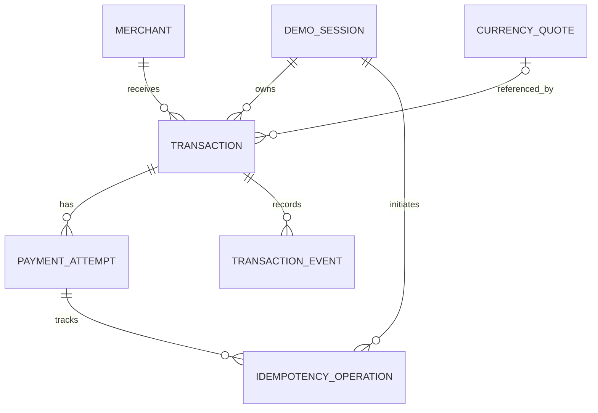

# GlobalPay — Database Schema

**Document version:** 1.0  
**Status:** Proposed data model for implementation; not evidence that migrations or tables already exist  
**Database:** MySQL (InnoDB)  
**ORM:** Prisma  
**Related documents:** PRD v1.2, `architecture.md`, `threat-model.md`, `designs.md`, `api-contract.md`

> GlobalPay is a hackathon prototype using PayPal Sandbox. The database stores application records and provider references; it does not represent a production cross-border settlement ledger. Sandbox payments do not move real money.

---

## 1. Goals and design principles

The schema must support:
- A catalogue of demo merchants.
- Server-owned sessions or authenticated users.
- Transactions and their payment attempts.
- Indicative currency quote snapshots.
- Idempotent payment-create and capture operations.
- A minimal audit trail for important state transitions.
- Safe recovery from provider timeouts and partial failures.
- Transaction ownership enforcement and efficient history queries.

### Non-negotiable principles

1. **Server-derived ownership:** never accept a `userId`, `sessionId`, or owner identifier from the client as proof of ownership.
2. **No client-authoritative payment status:** transaction completion is set only after server-side PayPal verification.
3. **Decimal-safe money:** use `Decimal` in Prisma and appropriate MySQL `DECIMAL` columns; never store money in binary floating point.
4. **Separate transaction from payment attempt:** one internal transaction may have one or more payment attempts, but retries must reuse or reconcile an existing attempt when appropriate.
5. **Provider calls are not part of a database transaction:** design for partial failure between a MySQL commit and an external PayPal API call.
6. **Minimal sensitive data:** store only data needed for the demo; never store card numbers, CVVs, PayPal passwords, or provider access tokens in application tables.
7. **No secrets in logs or audit events:** store safe event metadata only.
8. **Consistent status enums:** keep Prisma enums, API schemas, payment-flow logic, and UI labels aligned.

---

## 2. Identity and ownership: decision required

Before exposing transaction routes, choose one ownership strategy. The API contract currently leaves this decision open.

### Option A — authenticated users

Create a `User` model and associate transactions with `userId`. Derive the user ID from a server-validated session. Never trust a user ID from a request body.

### Option B — anonymous demo sessions

Create a server-issued `DemoSession` model. The session token should be high entropy and delivered using a secure, HttpOnly cookie in deployed environments. Prefer storing a hash of the token rather than the raw token. Resolve the session server-side and associate transactions with that session.

Do not treat a browser-generated ID, local-storage value, or guessable string as an ownership credential.

### Recommended MVP approach

If the hackathon demo does not need account registration, a **server-issued anonymous demo session** is likely simpler. This is a recommendation, not an already-made product decision. If selected, transaction queries and mutations must always scope to the resolved session. Add CSRF/origin protection for cookie-authenticated mutations.

The schema below models `DemoSession` as the owner. If the team chooses authenticated users, replace this ownership relation with `User` and preserve the same authorization invariants.

---

## 3. Entity relationship overview



Notes:
- A transaction may retain a reference to the quote used for its preview, plus a quote snapshot for reliable historical display.
- Payment attempts hold provider references and attempt-level states; the transaction holds the user-facing overall state.
- `TransactionEvent` is an application audit trail, not a substitute for provider verification or a regulated accounting ledger.
- `IdempotencyOperation` can be generalized to quote/assistant operations if needed, but payment create/capture are the critical first use cases.

---

## 4. Proposed models

### 4.1 `DemoSession`

Purpose: represent a server-issued anonymous demo session.

Suggested fields:
- `id`: opaque primary key.
- `tokenHash`: unique hash of the session token; never store the raw token if it can be avoided.
- `createdAt`, `updatedAt`.
- `expiresAt`: expiry time.
- `revokedAt`: nullable revocation time.
- Optional `lastSeenAt`, if useful and privacy-appropriate.

Indexes/constraints:
- Unique index on `tokenHash`.
- Index on `expiresAt` for cleanup.
- Do not log `tokenHash` or raw session cookie.

### 4.2 `Merchant`

Purpose: catalogue of merchants that the prototype explicitly supports.

Suggested fields:
- `id`: opaque primary key.
- `name`: display name.
- `slug`: unique stable slug for seeded demo merchants, if useful.
- `category`: controlled string or enum.
- `description`: optional public description.
- `countryCode`: optional ISO 3166-1 alpha-2 code.
- `displayCurrency`: supported ISO 4217 code.
- `supportedMethods`: use a normalized relation/table or a validated JSON field depending on complexity; for the MVP, a controlled enum list may be acceptable.
- `isDemo`: boolean.
- `isActive`: boolean.
- `createdAt`, `updatedAt`.

Constraints:
- Unique `slug` where used.
- Validate currency and country codes in application code; a plain `VARCHAR` alone does not guarantee valid codes.
- Only seed realistic-looking merchants if clearly marked as demo data.
- Do not add fake reviews, ratings, verification status, or unsupported payment methods.

### 4.3 `CurrencyQuote`

Purpose: record an indicative rate observation or a quote generated by the configured source.

Suggested fields:
- `id`: opaque primary key.
- `baseAmount`: `DECIMAL` with suitable precision.
- `baseCurrency`, `quoteCurrency`: three-letter currency codes.
- `convertedAmount`: `DECIMAL` with suitable precision.
- `rate`: high-precision `DECIMAL`.
- `source`: configured provider/source identifier.
- `asOf`: time associated with the rate data.
- `createdAt`.
- `expiresAt`: nullable.
- `isIndicative`: boolean; true for ordinary estimates.

Constraints:
- Do not call a hard-coded demo rate a “live” rate.
- Store the source and observed timestamp.
- Do not overwrite historical quote data when rates update; create a new record or a new immutable snapshot.
- Define decimal precision and rounding policy based on the actual currencies and quote source.
- Avoid storing unnecessary user-identifying data on quote records.

### 4.4 `Transaction`

Purpose: application-level transaction record displayed to the user.

Suggested fields:
- `id`: opaque primary key.
- `demoSessionId`: owner relation for anonymous demo-session mode.
- `merchantId`: relation to `Merchant`.
- `currencyQuoteId`: nullable relation to `CurrencyQuote`.
- `amount`: requested transaction amount as `DECIMAL`.
- `currency`: requested transaction currency.
- `status`: controlled `TransactionStatus`.
- `quoteSnapshot`: optional immutable JSON snapshot containing only the rate fields needed for historical display; if used, validate its shape and version it.
- `createdAt`, `updatedAt`.
- `completedAt`: nullable; set only after verified capture.
- `cancelledAt`: nullable if cancellation is a distinct state.
- `failureCode`: nullable, safe internal classification rather than raw provider text.

Constraints:
- Required owner relation in anonymous-session mode.
- Index `(demoSessionId, createdAt)` for activity queries.
- Index `(status, updatedAt)` for reconciliation workers/admin diagnostics if needed.
- Store requested amount/currency separately from quote base/converted values.
- Do not let a client directly update `status`, `completedAt`, `failureCode`, or provider fields.
- If user-account mode is selected, replace `demoSessionId` with `userId` and add a suitable index.

### 4.5 `PaymentAttempt`

Purpose: track a specific PayPal Sandbox order/capture attempt separately from the internal transaction.

Suggested fields:
- `id`: opaque primary key.
- `transactionId`: relation to `Transaction`.
- `provider`: enum/string such as `PAYPAL`.
- `environment`: enum/string such as `SANDBOX`.
- `status`: controlled `PaymentAttemptStatus`.
- `providerOrderId`: nullable provider order reference.
- `providerCaptureId`: nullable provider capture reference.
- `idempotencyScopeKey`: optional internal reference to the idempotency operation; do not store raw secrets.
- `amount`: the expected amount sent to the provider, as `DECIMAL`.
- `currency`: expected provider currency.
- `createdAt`, `updatedAt`.
- `approvedAt`: nullable.
- `captureRequestedAt`: nullable.
- `capturedAt`: nullable; only after verified capture.
- `lastCheckedAt`: nullable.
- `failureCode`: nullable safe classification.
- `providerStatus`: nullable normalized provider status; do not treat it as trusted until validated.
- `reconciliationNeeded`: boolean.
- `reconciliationAttempts`: integer defaulting to zero.

Constraints:
- Unique `(provider, environment, providerOrderId)` when provider order IDs are present, using a nullable-unique strategy supported by the chosen MySQL/Prisma versions.
- Unique `(provider, environment, providerCaptureId)` when capture IDs are present.
- Index `(transactionId, createdAt)`.
- Index `(reconciliationNeeded, updatedAt)` if a reconciliation worker is implemented.
- Never store provider access tokens, client secrets, full provider payloads by default, or payment credentials.
- Treat provider references as identifiers, not proof of success.

### 4.6 `IdempotencyOperation`

Purpose: make payment-create and capture operations safe to retry.

Suggested fields:
- `id`: opaque primary key.
- `demoSessionId`: owner relation.
- `transactionId`: relation to the transaction.
- `operationType`: controlled enum, e.g. `PAYPAL_CREATE` or `PAYPAL_CAPTURE`.
- `keyHash`: hash of the caller's idempotency key, scoped to the owner and operation.
- `requestFingerprint`: hash of normalized validated input, excluding secrets.
- `status`: `IN_PROGRESS`, `SUCCEEDED`, `FAILED`, or `UNKNOWN`.
- `httpStatus`: nullable stored response status if replay is needed.
- `safeResult`: optional JSON with a minimal non-secret result, or store only a pointer to the operation/attempt and reconstruct the response.
- `createdAt`, `updatedAt`, `expiresAt`: according to retention policy.

Constraints:
- Unique `(demoSessionId, operationType, keyHash)`.
- Index `(transactionId, operationType, createdAt)`.
- Reusing a key with a different request fingerprint returns a conflict.
- Do not store raw idempotency keys if hashing is sufficient.
- A failed network call may have an unknown provider outcome; don't mark it safely failed until reconciled.
- Avoid storing full response bodies containing checkout URLs or provider payloads unless there is a documented need.

### 4.7 `TransactionEvent`

Purpose: retain a minimal audit trail of meaningful state changes.

Suggested fields:
- `id`: opaque primary key.
- `transactionId`: relation to `Transaction`.
- `paymentAttemptId`: nullable relation to `PaymentAttempt`.
- `eventType`: controlled enum/string such as `TRANSACTION_CREATED`, `ORDER_CREATED`, `APPROVAL_OBSERVED`, `CAPTURE_REQUESTED`, `CAPTURE_VERIFIED`, `STATUS_UNCERTAIN`, `RECONCILIATION_COMPLETED`.
- `fromStatus`, `toStatus`: nullable normalized status strings.
- `source`: e.g. `API`, `PAYPAL_VERIFICATION`, `RECONCILIATION`.
- `requestId`: nullable correlation ID.
- `metadata`: optional, small, allowlisted JSON object with non-sensitive details.
- `createdAt`.

Constraints:
- Insert events from trusted server code only.
- Never log secrets, cookies, tokens, card data, raw prompts, or full provider payloads in metadata.
- Keep the event schema small; avoid collecting unnecessary personal information.
- Do not present this table as a tamper-proof financial audit ledger.

---

## 5. Prisma schema starter

This is a **starter schema** for the recommended anonymous-session MVP. It needs validation against the installed Prisma version and the final implementation decisions. Run `prisma validate` and generate migrations before using it. MySQL enum and nullable unique-index behavior should be checked with the selected Prisma/MySQL versions.

```prisma
generator client {
  provider = "prisma-client-js"
}

datasource db {
  provider = "mysql"
  url      = env("DATABASE_URL")
}

enum TransactionStatus {
  CREATED
  AWAITING_APPROVAL
  CAPTURE_PENDING
  COMPLETED
  CANCELLED
  FAILED
  STATUS_UNKNOWN
}

enum PaymentAttemptStatus {
  CREATED
  AWAITING_APPROVAL
  APPROVED
  CAPTURE_PENDING
  COMPLETED
  DENIED
  CANCELLED
  FAILED
  STATUS_UNKNOWN
}

enum PaymentProvider {
  PAYPAL
}

enum PaymentEnvironment {
  SANDBOX
}

enum IdempotencyOperationType {
  PAYPAL_CREATE
  PAYPAL_CAPTURE
}

enum IdempotencyStatus {
  IN_PROGRESS
  SUCCEEDED
  FAILED
  UNKNOWN
}

model DemoSession {
  id           String       @id @default(cuid()) @db.VarChar(30)
  tokenHash    String       @unique @db.VarChar(128)
  createdAt    DateTime     @default(now())
  updatedAt    DateTime     @updatedAt
  expiresAt    DateTime
  revokedAt    DateTime?
  lastSeenAt   DateTime?
  transactions Transaction[]
  operations   IdempotencyOperation[]

  @@index([expiresAt])
}

model Merchant {
  id               String        @id @default(cuid()) @db.VarChar(30)
  name             String        @db.VarChar(120)
  slug             String?       @unique @db.VarChar(140)
  category         String        @db.VarChar(40)
  description      String?       @db.VarChar(500)
  countryCode      String?       @db.Char(2)
  displayCurrency  String        @db.Char(3)
  supportedMethods Json
  isDemo           Boolean       @default(true)
  isActive         Boolean       @default(true)
  createdAt        DateTime      @default(now())
  updatedAt        DateTime      @updatedAt
  transactions     Transaction[]

  @@index([isActive, category])
}

model CurrencyQuote {
  id               String        @id @default(cuid()) @db.VarChar(30)
  baseAmount       Decimal       @db.Decimal(20, 8)
  baseCurrency     String        @db.Char(3)
  convertedAmount  Decimal       @db.Decimal(20, 8)
  quoteCurrency    String        @db.Char(3)
  rate             Decimal       @db.Decimal(24, 12)
  source           String        @db.VarChar(100)
  asOf             DateTime
  createdAt        DateTime      @default(now())
  expiresAt        DateTime?
  isIndicative     Boolean       @default(true)
  transactions     Transaction[]

  @@index([baseCurrency, quoteCurrency, asOf])
  @@index([expiresAt])
}

model Transaction {
  id               String             @id @default(cuid()) @db.VarChar(30)
  demoSessionId    String             @db.VarChar(30)
  merchantId       String             @db.VarChar(30)
  currencyQuoteId  String?            @db.VarChar(30)
  amount           Decimal            @db.Decimal(20, 8)
  currency         String             @db.Char(3)
  status           TransactionStatus  @default(CREATED)
  quoteSnapshot    Json?
  createdAt        DateTime           @default(now())
  updatedAt        DateTime           @updatedAt
  completedAt      DateTime?
  cancelledAt      DateTime?
  failureCode      String?            @db.VarChar(80)

  demoSession      DemoSession        @relation(fields: [demoSessionId], references: [id], onDelete: Restrict)
  merchant         Merchant           @relation(fields: [merchantId], references: [id], onDelete: Restrict)
  currencyQuote    CurrencyQuote?     @relation(fields: [currencyQuoteId], references: [id], onDelete: SetNull)
  paymentAttempts  PaymentAttempt[]
  events           TransactionEvent[]
  operations       IdempotencyOperation[]

  @@index([demoSessionId, createdAt])
  @@index([status, updatedAt])
  @@index([merchantId, createdAt])
}

model PaymentAttempt {
  id                    String             @id @default(cuid()) @db.VarChar(30)
  transactionId         String             @db.VarChar(30)
  provider              PaymentProvider    @default(PAYPAL)
  environment           PaymentEnvironment @default(SANDBOX)
  status                PaymentAttemptStatus @default(CREATED)
  providerOrderId       String?            @db.VarChar(120)
  providerCaptureId     String?            @db.VarChar(120)
  amount                Decimal            @db.Decimal(20, 8)
  currency              String             @db.Char(3)
  createdAt             DateTime           @default(now())
  updatedAt             DateTime           @updatedAt
  approvedAt            DateTime?
  captureRequestedAt    DateTime?
  capturedAt            DateTime?
  lastCheckedAt         DateTime?
  failureCode           String?            @db.VarChar(80)
  providerStatus        String?            @db.VarChar(80)
  reconciliationNeeded  Boolean            @default(false)
  reconciliationAttempts Int               @default(0)

  transaction           Transaction        @relation(fields: [transactionId], references: [id], onDelete: Restrict)
  events                TransactionEvent[]
  operations            IdempotencyOperation[]

  @@unique([provider, environment, providerOrderId])
  @@unique([provider, environment, providerCaptureId])
  @@index([transactionId, createdAt])
  @@index([reconciliationNeeded, updatedAt])
}

model IdempotencyOperation {
  id                 String                   @id @default(cuid()) @db.VarChar(30)
  demoSessionId      String                   @db.VarChar(30)
  transactionId      String                   @db.VarChar(30)
  paymentAttemptId   String?                  @db.VarChar(30)
  operationType      IdempotencyOperationType
  keyHash            String                   @db.VarChar(128)
  requestFingerprint String                   @db.VarChar(128)
  status             IdempotencyStatus        @default(IN_PROGRESS)
  httpStatus         Int?
  safeResult         Json?
  createdAt          DateTime                 @default(now())
  updatedAt          DateTime                 @updatedAt
  expiresAt          DateTime?

  demoSession        DemoSession              @relation(fields: [demoSessionId], references: [id], onDelete: Restrict)
  transaction        Transaction              @relation(fields: [transactionId], references: [id], onDelete: Restrict)
  paymentAttempt     PaymentAttempt?          @relation(fields: [paymentAttemptId], references: [id], onDelete: SetNull)

  @@unique([demoSessionId, operationType, keyHash])
  @@index([transactionId, operationType, createdAt])
  @@index([status, updatedAt])
}

model TransactionEvent {
  id                String          @id @default(cuid()) @db.VarChar(30)
  transactionId     String          @db.VarChar(30)
  paymentAttemptId  String?         @db.VarChar(30)
  eventType         String          @db.VarChar(80)
  fromStatus        String?         @db.VarChar(40)
  toStatus          String?         @db.VarChar(40)
  source            String          @db.VarChar(40)
  requestId         String?         @db.VarChar(100)
  metadata          Json?
  createdAt         DateTime        @default(now())

  transaction       Transaction     @relation(fields: [transactionId], references: [id], onDelete: Restrict)
  paymentAttempt    PaymentAttempt? @relation(fields: [paymentAttemptId], references: [id], onDelete: SetNull)

  @@index([transactionId, createdAt])
  @@index([paymentAttemptId, createdAt])
  @@index([eventType, createdAt])
}
```

### Schema review notes

Before applying this starter:
- Decide whether `supportedMethods` should be normalized into a separate `MerchantPaymentMethod` model. For a small MVP, a validated JSON array is simpler, but Prisma cannot enforce each JSON value as a database enum.
- Validate whether your selected Prisma version supports the exact MySQL JSON, enum, and nullable-unique behavior as expected.
- A composite unique index with nullable `providerOrderId` / `providerCaptureId` relies on MySQL's nullable unique-index behavior. Test this with migrations and concurrent inserts.
- `Decimal(20,8)` is a generic starter choice, not a universal currency rule. Define currency-specific precision and rounding in application code; provider payment amounts may need stricter limits.
- Consider whether `CurrencyQuote` should store amount-specific quote instances or normalized rate observations. The API contract currently shows amount-specific quotes.
- Add an explicit retention/cleanup policy for expired sessions and old idempotency records.
- Add database-level constraints where supported and useful; not every semantic rule can be expressed in Prisma schema.
- Do not apply migrations to a production database without review and a backup.

---

## 6. Relationship and deletion policy

Recommended default behavior:
- Do not hard-delete a transaction or payment attempt merely because a user hides it from the UI.
- Use restrictive deletion for records referenced by transactions or attempts.
- Expired demo sessions can be revoked immediately and cleaned up later according to a documented retention policy.
- Deleting or anonymizing session data must not destroy records needed to reconcile an uncertain provider payment.
- Merchant deactivation should use `isActive = false`, not delete historical merchant records.
- Quotes may be cleaned up only after the retention window and only if no transaction needs their snapshot/history.
- Idempotency records must be retained long enough to cover expected retries and provider reconciliation.
- Avoid indefinite retention of unnecessary user/session activity.

---

## 7. Transaction state invariants

Enforce these rules in server-side service logic, with database constraints or transactional checks where appropriate:

1. New transactions start as `CREATED`.
2. `AWAITING_APPROVAL` requires a stored provider order reference or a clearly documented transitional exception.
3. `CAPTURE_PENDING` means a capture has been requested or a provider outcome is being reconciled.
4. `COMPLETED` requires verified provider capture details matching the expected transaction.
5. `completedAt` is set only when status becomes `COMPLETED` after verification.
6. `FAILED` requires a confirmed failure, not merely a timeout.
7. `STATUS_UNKNOWN` remains unresolved until trusted provider data determines the outcome.
8. A duplicate request cannot create a second logical capture for the same provider order.
9. A payment attempt's amount/currency must match the expected stored transaction values used to create its order.
10. A transaction must be owned by the resolved session/user for every read and mutation.
11. Status transitions are performed by trusted server services, not arbitrary route handlers or AI tools.
12. State changes and their `TransactionEvent` records should be committed together in a database transaction where possible.

Because the database and PayPal cannot share one atomic transaction, use an explicit “operation in progress / outcome uncertain / reconcile” pattern around provider calls.

---

## 8. Suggested service boundaries

Keep Prisma access behind server-side services. Route handlers should validate input, resolve identity, call a service, and serialize a safe response.

Suggested services:
- `sessionService` — issue, validate, expire, and revoke demo sessions.
- `merchantService` — retrieve active public merchant data.
- `quoteService` — retrieve/validate indicative quotes and preserve source metadata.
- `transactionService` — create and read owner-scoped transaction records.
- `paymentService` — create orders, capture approved orders, verify provider data, and reconcile uncertain results.
- `idempotencyService` — reserve and resolve operation keys safely.
- `transactionEventService` — record minimal state-transition events.
- `assistantService` — invoke the model with authorized read-only context.

Do not let a UI component or AI model call Prisma directly. Do not expose the Prisma client to client-side bundles.

---

## 9. Migration and seed guidance

Recommended implementation sequence:
1. Confirm the identity/ownership approach.
2. Finalize transaction and payment status enums against `api-contract.md` and `payment-flow.md`.
3. Implement `schema.prisma`.
4. Run `npx prisma validate`.
5. Generate a development migration with `npx prisma migrate dev --name init`.
6. Review the SQL migration before applying it.
7. Add a deterministic seed script for clearly marked demo merchants.
8. Keep seed data free of real user or payment information.
9. Test unique constraints, foreign keys, decimal serialization, and concurrent idempotency writes.
10. Test a fresh database setup from zero and document the commands in `setup-and-environment.md`.

Use the actual package scripts and Prisma version selected in the repository. Do not assume a migration has been generated or applied simply because the schema file exists.

---

## 10. Database test checklist

### Ownership
- [ ] A session can only list its own transactions.
- [ ] A session cannot retrieve or mutate another session's transaction by guessing an ID.
- [ ] Revoked and expired sessions cannot access user-specific records.
- [ ] Client-supplied owner identifiers are ignored or rejected.

### Integrity
- [ ] Transaction amount and currency are stored as decimal/string-safe values.
- [ ] Merchant and transaction foreign keys are enforced.
- [ ] Provider order IDs and capture IDs cannot be accidentally attached to multiple attempts where uniqueness is required.
- [ ] Quote snapshots preserve the rate/source/time used at transaction creation.
- [ ] Merchant deactivation preserves historical transaction references.

### Payment resilience
- [ ] Duplicate idempotency keys do not create duplicate attempts.
- [ ] Conflicting key reuse is rejected.
- [ ] Concurrent create/capture requests are handled safely.
- [ ] An ambiguous provider outcome sets reconciliation state rather than a false failure.
- [ ] A transaction cannot become `COMPLETED` without a verified provider capture.
- [ ] Event records are committed with state transitions where possible.

### Operations and privacy
- [ ] Expired sessions and old idempotency records follow the documented retention policy.
- [ ] Logs and event metadata contain no secrets or unnecessary personal data.
- [ ] Migrations work from a clean database.
- [ ] The seed script is repeatable and creates only demo data.
- [ ] Indexes support session-scoped history and reconciliation queries.

---

## 11. Open decisions before finalizing the schema

1. Confirm anonymous demo session vs authenticated users.
2. Confirm exact transaction/payment-attempt state enums and transitions.
3. Decide whether merchant payment methods remain JSON or become a normalized table.
4. Choose the currency quote source and whether quotes are amount-specific records or rate observations.
5. Choose exact amount precision, rounding, and supported-currency rules.
6. Decide the retention window for sessions, idempotency operations, quotes, and events.
7. Confirm whether a reconciliation worker will run automatically or only on user-triggered status checks.
8. Confirm Prisma version and validate the schema against it.
9. Align any renamed fields with the API contract and implementation.
10. Review the model against the threat model before applying migrations.

**Final invariant:** the database records what GlobalPay has verified and what it still does not know. It must never turn a client claim, an AI statement, or a provider timeout into a successful payment.
