# GlobalPay — Payment Flow Specification

**Document status:** Proposed design for implementation  
**Product scope:** GlobalPay hackathon prototype; PayPal Sandbox only  
**Companion documents:** `architecture.md`, `threat-model.md`, `designs.md`, `api-contract.md`, `database-schema.md`

> This document specifies intended behavior. It does not claim that any endpoint, database model, or PayPal integration has already been implemented. Validate the design against the PayPal Sandbox API and the versions of Next.js, Prisma, and other dependencies selected for the project before implementation.

---

## 1. Purpose and non-negotiable rules

This document connects the database and API proposals into one end-to-end payment lifecycle: create a demo transaction, create a PayPal Sandbox order, obtain buyer approval, capture on the server, verify the provider response, and show the resulting status.

GlobalPay is a **demonstration prototype**. It does not provide actual cross-border payment rails, guarantee live exchange rates, or move real money. The interface must clearly label Sandbox payments and indicative currency conversions.

### Payment invariants

1. **The server owns GlobalPay transaction state.** Browser navigation, query parameters, PayPal return URLs, and frontend state are not evidence that a payment succeeded.
2. **PayPal is authoritative for PayPal order/capture status.** GlobalPay may mark a payment `COMPLETED` only after the server has received and validated a successful provider capture result or a trusted reconciliation lookup.
3. **The server determines the amount and currency.** Never accept the payable amount, recipient, fee, or final currency from an untrusted client without recomputing and validating it from server-held transaction/quote/merchant data.
4. **Persist before external side effects.** Create the transaction and payment-attempt record before calling PayPal. Do not hold a database transaction open while waiting on the network.
5. **Retries must be safe.** Repeated requests must not create duplicate logical transactions, PayPal orders, or captures. Use scoped idempotency keys, provider request IDs where supported, uniqueness constraints, and concurrency-safe state transitions.
6. **Unknown is not failure.** If a request times out after it may have reached PayPal, record an uncertain state and reconcile. Do not tell the user the payment failed or immediately create a second order.
7. **AI is read-only.** The assistant may explain statuses or estimate costs, but it cannot create or capture a payment, change transaction state, or assert success without reading server-confirmed status.
8. **Secrets stay on the server.** PayPal credentials and other private keys must never enter browser bundles, client-visible environment variables, logs, or AI prompts.

---

## 2. Actors and trust boundaries

- **Buyer/browser:** chooses a demo merchant, reviews an indicative quote, and approves or cancels the PayPal Sandbox flow.
- **GlobalPay server:** authenticates/identifies the demo session, validates input, calculates totals, persists state, calls PayPal, verifies provider responses, and serves authoritative transaction status.
- **MySQL database:** stores GlobalPay records, idempotency records, and auditable state transitions.
- **PayPal Sandbox:** creates provider orders and reports approval/capture outcomes for the test environment.
- **AI assistant:** has read-only access to carefully scoped application data and must not control payment state.

### Session ownership prerequisite

The companion schema proposes a server-issued anonymous `DemoSession`, but the exact session strategy remains an implementation decision. Before exposing transaction or payment endpoints, select and implement a session mechanism. Every transaction, quote, idempotency record, and payment attempt must be scoped to the appropriate owner/session. Do not rely on an opaque transaction ID alone as authorization.

For an anonymous demo, use a high-entropy server-generated session identifier in a secure, `HttpOnly`, `SameSite` cookie; choose `Secure` for HTTPS deployments. Apply appropriate expiry, CSRF/origin protections to state-changing routes, and rate limits. Do not put the session secret in a URL or browser storage. These are design recommendations and must be reviewed for the final deployment.

---

## 3. Proposed payment state machine

The following are **GlobalPay application states**, not necessarily literal PayPal status names.

```mermaid
stateDiagram-v2
    [*] --> CREATED
    CREATED --> AWAITING_APPROVAL: PayPal order created and verified
    CREATED --> FAILED: definite pre-approval error
    CREATED --> STATUS_UNKNOWN: provider result uncertain

    AWAITING_APPROVAL --> CAPTURE_PENDING: approval received; server capture begins
    AWAITING_APPROVAL --> CANCELLED: buyer cancels / order is confirmed not approved
    AWAITING_APPROVAL --> STATUS_UNKNOWN: return or provider outcome uncertain
    AWAITING_APPROVAL --> FAILED: provider confirms terminal failure

    CAPTURE_PENDING --> COMPLETED: capture verified successful
    CAPTURE_PENDING --> FAILED: provider confirms terminal capture failure
    CAPTURE_PENDING --> STATUS_UNKNOWN: timeout / ambiguous response

    STATUS_UNKNOWN --> COMPLETED: reconciliation confirms successful capture
    STATUS_UNKNOWN --> AWAITING_APPROVAL: reconciliation confirms order still awaits approval
    STATUS_UNKNOWN --> CANCELLED: reconciliation confirms cancellation / expiry
    STATUS_UNKNOWN --> FAILED: reconciliation confirms terminal failure
    STATUS_UNKNOWN --> CAPTURE_PENDING: safe capture retry is established

    COMPLETED --> [*]
    CANCELLED --> [*]
    FAILED --> [*]
```



### State meanings

| State | Meaning | User-facing guidance |
|---|---|---|
| `CREATED` | GlobalPay transaction exists; payment setup has not yet been confirmed. | “Preparing your Sandbox payment…” |
| `AWAITING_APPROVAL` | A verified PayPal Sandbox order exists and awaits buyer approval. | “Continue to PayPal Sandbox to approve.” |
| `CAPTURE_PENDING` | The server is attempting capture or checking a capture result. | “Confirming payment status. Please don’t retry yet.” |
| `COMPLETED` | A successful capture has been validated with PayPal or confirmed by reconciliation. | “Sandbox payment completed.” |
| `CANCELLED` | Cancellation is confirmed and no successful capture exists. | “Payment cancelled. No successful Sandbox capture was recorded.” |
| `FAILED` | A terminal failure is confirmed, or a definite error occurred before a payment could be created. | Explain that the Sandbox attempt failed; only offer a retry when the previous attempt is known safe to retry. |
| `STATUS_UNKNOWN` | The provider outcome cannot yet be determined safely. | “We’re checking the Sandbox result. Please keep this page open or check transaction status shortly.” |

**Do not force every exception into `FAILED`.** A timeout, dropped connection, malformed/partial response, or server restart after a provider request may leave the outcome unknown.

---

## 4. End-to-end sequence

```mermaid
sequenceDiagram
    actor Buyer
    participant UI as Browser UI
    participant API as GlobalPay Server
    participant DB as MySQL
    participant PP as PayPal Sandbox

    Buyer->>UI: Choose merchant and review indicative quote
    UI->>API: POST transaction (client idempotency key)
    API->>DB: Validate owner; persist transaction + event
    DB-->>API: Transaction ID
    API-->>UI: Transaction summary + authoritative amount/currency

    Buyer->>UI: Select PayPal Sandbox
    UI->>API: POST PayPal create (idempotency key)
    API->>DB: Reserve attempt; persist intent
    API->>PP: Create order using server-calculated amount/currency
    PP-->>API: Order response
    API->>API: Validate order ID, status, amount, currency, payee/context
    API->>DB: Persist provider order ID + AWAITING_APPROVAL
    API-->>UI: Approval URL + GlobalPay transaction ID

    UI->>PP: Redirect buyer to approval URL
    Buyer->>PP: Approve or cancel Sandbox order
    PP-->>UI: Return to configured GlobalPay return/cancel route
    UI->>API: Request transaction status / initiate capture flow
    Note over UI,API: Return navigation is not proof of approval or capture

    API->>DB: Lock/claim eligible attempt; persist CAPTURE_PENDING
    API->>PP: Capture order on server (idempotent where supported)
    PP-->>API: Capture response
    API->>API: Validate provider order/capture IDs, status, amount, currency
    API->>DB: Persist provider evidence + final state + event
    API-->>UI: Authoritative transaction status
    UI->>Buyer: Show verified result
```

This sequence is conceptual. The exact browser redirect mechanics and PayPal response fields must follow the selected PayPal Checkout integration and its current Sandbox documentation.

---

## 5. Step-by-step lifecycle

### Step 0 — Select a merchant and review the quote

1. The UI loads only known demo merchants from the server.
2. The user selects a merchant and enters or confirms the demo payment details required by the product.
3. The server validates the merchant, supported currency, amount limits, and session ownership.
4. The server calculates the payable amount from trusted server-side rules. If an indicative conversion quote is used, store its source, timestamp, rate, input/output currencies, and rounding rules.
5. The UI presents the final Sandbox amount and any indicative conversion details before continuing.

**Important:** a displayed conversion is an estimate for the prototype, not a promise of an executable foreign-exchange rate. Do not imply that PayPal is executing a conversion unless the actual provider transaction confirms that fact.

### Step 1 — Create the GlobalPay transaction

**Proposed endpoint:** `POST /api/transactions` (see `api-contract.md`).

The server should:

1. Identify the session/owner and validate CSRF/origin controls as applicable.
2. Validate merchant and quote IDs against server-held records.
3. Recompute or verify the total, fees, currency, and rounding on the server.
4. Create the `Transaction` and initial `TransactionEvent` in one database transaction.
5. Enforce the client idempotency key within the correct session and operation scope.
6. Return the authoritative transaction summary.

If the same request is repeated with the same idempotency key and equivalent request payload, return the original logical result. If the key is reused with a different payload, return a conflict rather than silently changing the transaction.

Do not create a PayPal order at this step unless the implementation intentionally combines the operations and still preserves the required idempotency and audit guarantees.

### Step 2 — Prepare a PayPal Sandbox order

**Proposed endpoint:** `POST /api/payments/paypal/create`.

The server should:

1. Verify the transaction belongs to the caller and is eligible for payment.
2. Check whether a valid existing order/attempt already exists. If so, return the same safe-to-reuse approval information instead of creating a duplicate.
3. Reserve a new payment attempt and persist the intent before the network call. Use a unique attempt identifier and an idempotency/request ID where supported by PayPal.
4. Call PayPal Sandbox using server-only credentials and the amount/currency derived from the stored transaction.
5. Validate the response. At minimum, bind the returned provider order ID to the expected transaction/attempt and check the expected amount/currency and relevant payee/context fields available in the response.
6. Persist the provider order ID and verified approval URL, then transition to `AWAITING_APPROVAL`.
7. Return only the fields the UI needs, such as the GlobalPay transaction ID, safe display summary, and validated approval URL.

If the call definitively fails before an order is created, mark the attempt appropriately and allow a safe retry. If the request may have reached PayPal but the response is lost, set `STATUS_UNKNOWN` and reconcile before attempting to create another order.

**Approval URL safety:** only redirect to a URL extracted from a validated PayPal response and matching the expected HTTPS PayPal Sandbox host/approved integration pattern. Never redirect to a URL supplied by the user or AI.

### Step 3 — Buyer approval or cancellation

The browser redirects the buyer to the PayPal Sandbox approval flow. After the buyer approves or cancels, PayPal redirects to the configured return/cancel route.

The browser return means only that navigation occurred. It does **not** establish that:
- the order is approved,
- a capture was attempted,
- the capture succeeded, or
- the GlobalPay transaction is completed.

The UI should display a neutral “Checking payment status…” state and ask the server to verify the order and decide whether capture is eligible. Do not trust client-supplied order IDs, status labels, amounts, or success flags without matching them to the stored transaction and server-side provider records.

If the user cancels, the server should verify the order’s actual provider status before marking the transaction `CANCELLED`. A return to the cancel route alone is not proof that no capture exists.

### Step 4 — Capture on the server

**Proposed endpoint:** `POST /api/payments/paypal/capture`.

The server should:

1. Resolve the transaction and payment attempt from server-held identifiers; verify session ownership.
2. For a fresh capture, atomically transition only `AWAITING_APPROVAL` to `CAPTURE_PENDING`; never include `CAPTURE_PENDING` in fresh acquisition eligibility.
3. For `STATUS_UNKNOWN` or stale `CAPTURE_PENDING`, acquire the database-backed attempt lease before inquiry. Only the lease holder queries PayPal and decides whether capture is safe.
4. Query the stored PayPal order and verify its order ID, amount, currency, and configured payee before deciding to capture. An already completed order must be recovered without another capture. An approved order with no capture may proceed through the safe capture path.
5. Send the capture request from the server using one stable `PayPal-Request-Id` for the logical payment attempt, regardless of a caller retry or a different HTTP idempotency key.
6. Validate the response against the expected order and transaction. Confirm successful provider status and validate capture ID, exact decimal amount, currency, and configured payee.
7. Persist the result and related transaction/attempt event atomically. Keep only allowlisted provider evidence needed for reconciliation; never persist secrets, tokens, or raw provider payloads.
8. If a provider capture response is missing required evidence or fails verification, set both transaction and attempt to `STATUS_UNKNOWN`, set `reconciliationNeeded: true`, preserve the capture ID if supplied, and record a structured event. Never mark this result `FAILED`/`DENIED` or invent a capture ID.
9. Return the authoritative GlobalPay status; unresolved results remain pending/unknown and must not offer a blind new capture.

**No open database transaction across the PayPal network call.** Use short database transactions to reserve/claim the attempt and later persist the result. A process crash between the provider call and database update must be recoverable by reconciliation.

A successful HTTP response alone is insufficient. The server must inspect and validate the relevant provider result fields.

### Step 5 — Show authoritative status

The UI obtains transaction status from the GlobalPay server, using the authenticated/owned transaction route. It renders only the state returned by the server.

- `COMPLETED`: show “Sandbox payment completed” and the safe transaction summary.
- `AWAITING_APPROVAL`: offer the validated approval action again if the provider order is still eligible.
- `CAPTURE_PENDING`: show a progress state and poll with bounded backoff.
- `STATUS_UNKNOWN`: explain that the result is being checked; provide a “Check status” action.
- `CANCELLED`: show cancellation only after the server has verified the outcome.
- `FAILED`: show a retry action only after the previous attempt is confirmed safe to retry.

The client may optimistically animate buttons or transitions, but must never optimistically set the payment state to `COMPLETED`.

---

## 6. Timeout, retry, and reconciliation policy

Network timeouts are especially important because a request can succeed at PayPal even when GlobalPay does not receive the response.

| Situation | Immediate action | Reconciliation requirement | Retry rule |
|---|---|---|---|
| Validation fails before provider call | Return a validation error; preserve or mark the logical transaction appropriately. | Usually none. | Correct the input; do not reuse a mismatched idempotency payload. |
| PayPal order creation definitively rejected | Record the provider error safely and update the attempt. | Only if response semantics are ambiguous. | Retry with a new attempt or provider-supported idempotency key according to the recorded outcome. |
| Order creation times out / connection drops | Mark `STATUS_UNKNOWN`; preserve attempt and request identifiers. | Search/query provider state using supported mechanisms and stored correlation data. | Do not create a second order until the first outcome is resolved or a safe duplicate-prevention strategy is established. |
| Buyer returns but approval status is unclear | Keep the transaction non-completed. | Query the stored PayPal order. | Capture only when provider state makes it eligible. |
| Capture definitively succeeds | Persist `COMPLETED` and capture reference. | Reconcile if persistence failed or evidence is incomplete. | Never capture again merely because the browser did not receive the response. |
| Capture times out / response lost | Mark `STATUS_UNKNOWN` (or preserve `CAPTURE_PENDING` with a bounded age policy); do not claim success/failure. | Query the known order/capture using supported provider APIs. | Do not blindly repeat capture; establish provider state and use idempotency where supported. |
| Capture response is received but verification fails or fields are missing | Persist `STATUS_UNKNOWN`, `reconciliationNeeded: true`, any supplied capture ID, and a structured verification event. | Re-query PayPal and re-verify status, exact amount, currency, capture ID, and payee. | Do not mark failed/denied or capture again until inquiry establishes a safe path. |
| Process crashes after provider success but before DB update | On recovery, find stale pending attempts. | Query PayPal and repair local state with an auditable event. | Do not create another order/capture until reconciled. |
| User double-clicks or sends concurrent requests | Enforce idempotency, unique constraints, and atomic claim/compare-and-set state transitions. | Reconcile if two requests reached the provider unexpectedly. | Return the existing attempt/status where safe. |

### Reconciliation worker or service

A reconciliation mechanism should scan for stale `CREATED`, `CAPTURE_PENDING`, and `STATUS_UNKNOWN` attempts, subject to rate limits and bounded retry schedules.

For each attempt:

1. Load the transaction, attempt, stored PayPal order ID, provider request identifiers, and last-known state.
2. Query PayPal using the documented Sandbox API for the stored order/capture.
3. Validate the response against the stored transaction’s expected amount, currency, and identifiers.
4. Transition state only from verified provider evidence.
5. Write a `TransactionEvent` describing the reconciliation result, with safe error codes and timestamps.
6. Use bounded retries with exponential backoff and jitter for transient provider failures.
7. Escalate unresolved cases to an operational/admin view or a clearly labelled “still checking” state. Do not invent a successful or failed result to make the UI look tidy.

If webhooks are added later, validate their signatures using PayPal’s documented mechanism and make processing idempotent. A webhook should trigger verification/reconciliation; do not trust an arbitrary unsigned request body as proof of payment.

**Implementation note:** for a short hackathon prototype, reconciliation may initially be an explicit server-side “check status” operation plus a scheduled/stale-attempt job. Do not silently omit reconciliation for ambiguous capture outcomes.

---

## 7. Concurrency, idempotency, and database rules

The proposed models in `database-schema.md` should support these behaviors. Exact fields and constraints must be checked against the final Prisma schema and migration.

### Required protections

- Scope idempotency by session/owner and operation, not globally by an untrusted key alone.
- Store a request fingerprint/hash so reusing a key with a different payload returns a conflict.
- Use a unique constraint for provider order IDs and provider capture IDs where applicable.
- Ensure one active capture operation per payment attempt.
- Use a conditional `AWAITING_APPROVAL` → `CAPTURE_PENDING` transition for fresh acquisition; a request cannot acquire `CAPTURE_PENDING` as a fresh operation.
- Use an atomic per-attempt lease for `STATUS_UNKNOWN` recovery and stale-pending reconciliation. Expired leases allow crash recovery; concurrent callers cannot independently query and dispatch.
- Query PayPal before any recovery decision. Reuse a stable provider request ID for the same payment attempt, including calls made with different HTTP idempotency keys.
- Compare provider monetary strings with decimal-safe arithmetic; missing provider fields never default to expected values.
- Make state transitions explicit and validate allowed source → target transitions in a service layer.
- Persist state changes and `TransactionEvent` records together where practical.
- Keep provider error details redacted and bounded; never log credentials, access tokens, full payment instruments, or raw secrets.
- Apply unique constraints to provider references and idempotency records to back up application-level checks.
- Define how long idempotency keys and audit events are retained, considering the prototype’s data minimization goals.

### Suggested transition guard examples

- `CREATED → AWAITING_APPROVAL` only after a PayPal order is created and the returned order data is validated.
- `AWAITING_APPROVAL → CAPTURE_PENDING` only after the server confirms capture is eligible and has claimed the attempt.
- `CAPTURE_PENDING → COMPLETED` only with validated successful capture evidence.
- Any post-capture verification failure or missing field transitions to `STATUS_UNKNOWN` with reconciliation required, not `FAILED`/`DENIED`.
- `STATUS_UNKNOWN → COMPLETED` only after provider reconciliation confirms success.
- `COMPLETED` is terminal for ordinary user actions; never transition it back to pending because of a later browser request.
- A repeated capture request for a completed attempt returns the existing completed result rather than issuing another provider call.

These are application-level rules. Provider-specific status names and allowed actions must be mapped from the current PayPal Checkout documentation.

---

## 8. Frontend experience and motion

The payment experience should feel responsive without implying an unverified result.

### Recommended UI sequence

1. **Review:** show merchant, original amount/currency, indicative conversion (if applicable), fee breakdown, and final Sandbox amount.
2. **Preparing:** disable repeated clicks while the server prepares the order; retain an accessible status announcement.
3. **Approval:** redirect to the validated PayPal Sandbox approval URL.
4. **Returning:** show a calm “Checking payment status…” view after return.
5. **Pending/unknown:** show progress, last-check time, and a manual status-check action; explain not to start another payment while the result is unresolved.
6. **Completed:** show a success treatment only after server-confirmed completion, with a clear Sandbox label and transaction reference.
7. **Cancelled/failed:** explain the confirmed result and provide next steps only when safe.

### Motion guidance

- Use Motion for React for short opacity/position transitions, button feedback, and progress indicators.
- Respect `prefers-reduced-motion`; motion must not be the only status signal.
- Keep the primary action disabled while a request is in flight, but do not rely on disabled UI as the duplicate-payment safeguard.
- Avoid celebratory success animation until the server returns `COMPLETED`.
- Make the status text accessible to assistive technology (for example, an appropriate `aria-live` region).
- On reload, reconstruct the screen from the server’s authoritative transaction status rather than from stale client state.

---

## 9. API responsibilities

Refer to `api-contract.md` for the proposed endpoint shapes. The key division of responsibilities is:

| Operation | Browser responsibility | Server responsibility |
|---|---|---|
| Create transaction | Submit merchant/quote/intent and idempotency key | Validate ownership, compute total, persist transaction |
| Create PayPal order | Request payment setup | Validate transaction, reserve attempt, call PayPal, persist verified order |
| Approve | Navigate buyer to the validated approval URL | Keep state non-completed until provider verification |
| Capture | Request capture/check flow; never send authoritative payment claims | Claim attempt, call PayPal, validate capture, persist state |
| Check status | Render response and request refresh | Return owned transaction state; reconcile when required |
| Assistant explanation | Ask a question about transaction/quote | Read only authorized data; clearly distinguish estimates from confirmed status |

All endpoint names are proposals. Do not assume the browser must call capture immediately after returning from PayPal; the server must first establish the order state and capture eligibility.

---

## 10. Test matrix

The following cases should be automated where practical and manually exercised in the PayPal Sandbox.

| ID | Scenario | Expected behavior |
|---|---|---|
| PF-01 | Happy path: create transaction, order, approve, capture | Server verifies capture; state becomes `COMPLETED` once. |
| PF-02 | User cancels at PayPal | State remains non-completed until server verifies cancellation; then `CANCELLED`. |
| PF-03 | User changes return URL parameters | No unauthorized transaction access; no success state from client data. |
| PF-04 | Client submits a different amount/currency | Server rejects or ignores client total and uses stored server-side values. |
| PF-05 | Two simultaneous create-order requests | One logical attempt/order is reused or safely deduplicated. |
| PF-06 | Two simultaneous capture requests | One capture operation is claimed; the other returns existing/pending status. |
| PF-07 | Same idempotency key, same payload | Existing logical result is returned. |
| PF-08 | Same idempotency key, changed payload | Conflict; no mutation or duplicate provider operation. |
| PF-09 | Order creation timeout after provider accepted request | `STATUS_UNKNOWN`; reconciliation before another order is created. |
| PF-10 | Capture timeout after provider succeeded | No false failure and no blind second capture; reconciliation confirms the result. |
| PF-11 | Process crashes after capture response before DB commit | Recovery reconciles provider state and repairs local state. |
| PF-12 | Provider returns mismatched amount/currency/order | Do not mark completed; record a redacted integrity error and investigate. |
| PF-13 | Request comes from another session | Deny access without revealing transaction details. |
| PF-14 | AI assistant is asked to mark a payment complete | Refuse action; report only server-confirmed status. |
| PF-15 | Reload while capture is pending | UI rehydrates from server state and does not issue duplicate capture automatically. |
| PF-16 | Provider unavailable during status check | Keep pending/unknown with bounded retry guidance. |
| PF-17 | Unsupported merchant/currency or expired quote | Reject before provider call. |
| PF-18 | Motion reduced preference enabled | Status and controls remain understandable without nonessential animation. |

---

## 11. Logging, privacy, and operations

Log enough to trace a payment attempt without recording secrets or excessive personal data.

Recommended correlation fields:
- GlobalPay transaction ID
- Payment attempt ID
- Provider order/capture IDs, where safe and useful
- Idempotency operation ID or a non-secret correlation reference
- State before and after transition
- Operation name and duration
- Provider HTTP status / documented error code
- Reconciliation attempt number and timestamp

Do not log:
- PayPal client secret, access tokens, session secrets, or raw authorization headers
- Full card/payment instrument details
- Unredacted provider payloads without a justified, reviewed need
- Sensitive information placed in user prompts or AI context

For a prototype, keep retention short and disclose what demo data is stored. Provide a way to clear/reset demo data where feasible, without compromising auditability during an active attempt.

---

## 12. Release checklist

Before presenting the demo:

- [ ] PayPal Sandbox credentials are server-only and the app visibly says Sandbox/test payment.
- [ ] The chosen session/ownership mechanism is implemented and tested.
- [ ] Server-derived amount/currency/merchant are used for provider order and capture validation.
- [ ] No client callback or AI response can mark a transaction completed.
- [ ] Order creation and capture have idempotency and concurrency protection.
- [ ] Timeouts enter an unknown/pending path and are reconciled before retry.
- [ ] Provider order/capture references are persisted with uniqueness protection.
- [ ] Capture result validation checks the expected order, capture status, amount, currency, and relevant payee/context fields available.
- [ ] State transitions and transaction events are recorded.
- [ ] Client refreshes/polls authoritative server status.
- [ ] Tests PF-01 through PF-18 pass or any unimplemented cases are explicitly documented as demo limitations.
- [ ] Logs contain correlation data but no credentials or session secrets.
- [ ] Indicative FX is labelled as an estimate and is not represented as a guaranteed executed conversion.
- [ ] The AI assistant is read-only for payment-related tools.
- [ ] The demo script includes cancellation, pending/unknown, and successful Sandbox scenarios.

---

## 13. Decisions to resolve before implementation

1. **Session ownership:** choose and document anonymous demo session vs. account-based auth. The schema currently proposes `DemoSession`; this remains unresolved.
2. **Capture trigger:** choose whether capture is requested by a return-route server action or a separate client-triggered endpoint. In either case, the server must independently verify eligibility and provider state.
3. **Reconciliation mechanism:** decide between a scheduled job, explicit status-check endpoint, or both. A timeout after a possible capture must not be ignored.
4. **PayPal integration shape:** confirm the current Checkout flow, order intent, approval links, capture semantics, idempotency/request headers, and Sandbox configuration against official documentation.
5. **Quote lifecycle:** decide how long quotes remain valid and whether a transaction snapshots a quote at creation.
6. **Retention/reset policy:** set a demo data retention window and safe reset behavior.
7. **Provider status mapping:** define the exact mapping from PayPal order/capture statuses to GlobalPay states using the current API documentation.

**Suggested implementation order:** session/ownership → schema and migrations → transaction creation → PayPal order creation → approval return/status verification → capture → reconciliation → UI pending/unknown states → tests and demo rehearsal.
