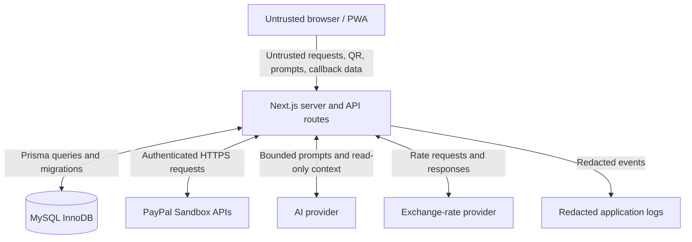

# GlobalPay — Threat Model

**Document version:** 1.0  
**Status:** MVP security planning document  
**Product:** GlobalPay — AI-assisted international travel payment PWA  
**Applies to:** PayPal Sandbox hackathon prototype  
**Related documents:** `architecture.md`, `api-contract.md`, `payment-state-machine.md`, `ai-guardrails.md`

> **Scope note:** This threat model is for a hackathon demonstration. It does not establish that GlobalPay is suitable for production payments, regulated financial services, or real-money cross-border transfers.

---

## 1. Purpose

Identify GlobalPay's important assets, trust boundaries, likely attackers, abuse cases, and minimum mitigations before implementation. This document should guide design decisions and security tests; it is not a claim that the controls have already been implemented or independently audited.

## 2. Scope and assumptions

### In scope

- Next.js / React / TypeScript web application and API routes.
- MySQL (InnoDB) persistence through Prisma ORM.
- PayPal Sandbox order creation, approval, capture, and verification.
- Merchant selection and demo QR payload parsing.
- Indicative currency conversion.
- AI assistant and its read-only tools.
- Transaction history and receipt access.
- Deployment configuration, logs, and PWA caching.

### Out of scope for this MVP

- Real-money payment processing or actual cross-border payment rails.
- Storing or processing raw card numbers, CVVs, or PayPal credentials belonging to end users.
- Production financial compliance certification.
- Full interoperability with arbitrary merchant QR systems.
- Refunds, chargebacks, settlement, or custody of funds unless explicitly added to the PRD later.

### Assumptions to confirm

1. All payment activity is in PayPal Sandbox.
2. Merchant fixtures and demo prices are controlled by the server.
3. The AI assistant is not allowed to initiate, capture, approve, or refund payments.
4. The browser is untrusted, even when using the intended UI.
5. Provider APIs, QR payloads, user prompts, and browser callback parameters may be malformed or malicious.
6. Anonymous transaction access needs a defined session/ownership mechanism before history and receipt routes are exposed.
7. The application is deployed over HTTPS.
8. MySQL is accessed through Prisma from server-only code.

If an assumption changes, revisit the threats and controls affected by that change.

## 3. Assets and security objectives

| Asset | Why it matters | Security objective |
|---|---|---|
| PayPal client secret and access tokens | Could enable misuse of the application's provider integration | Keep server-side; restrict access; rotate if exposed |
| AI provider API key | Could be stolen and abused for cost or account misuse | Keep server-side; restrict and rotate if exposed |
| MySQL credentials | Could expose or alter transaction records | Keep server-side; least privilege; protected connection |
| Transaction state and provider identifiers | Used to represent the checkout lifecycle | Integrity, authorization, and reliable reconciliation |
| Merchant prices and currency configuration | Determine expected checkout amount | Server authority; prevent client/QR tampering |
| PayPal order and capture results | Evidence of external payment state | Verify provider response and match expected details |
| Transaction history and receipts | May reveal a user's activity | Restrict access; minimise stored data |
| Exchange-rate values and timestamps | Influence estimates shown to travellers | Validate source, freshness, and calculation |
| AI tool permissions and outputs | Could mislead users or expose data | Narrow permissions; validate; never use as payment authority |
| QR payloads | Can contain attacker-controlled content | Strict schema validation; no arbitrary URL fetching |
| Logs and error traces | May contain secrets or sensitive transaction data | Redaction, access restriction, minimal retention |
| Build artifacts and client bundle | Could accidentally expose secrets | Secret scanning and bundle review |
| User trust and product claims | Misleading UI could imply real payment capability | Label Sandbox and indicative values clearly |

### Core security objectives

- **Confidentiality:** secrets and private transaction data are not exposed to unauthorised parties.
- **Integrity:** client input cannot alter trusted prices or falsely mark payments completed.
- **Availability:** bounded inputs, timeouts, and rate limits reduce simple resource-exhaustion abuse.
- **Authenticity:** PayPal status is verified through server-to-server provider interaction.
- **Accountability:** useful, redacted state-transition logs support debugging and reconciliation.
- **Transparency:** sandbox payment status, indicative rates, and product limitations are communicated accurately.

## 4. Trust boundaries and data flows

Treat each arrow crossing a trust boundary as a place to validate data, authenticate the other side where applicable, enforce permissions, set timeouts, and decide what may be logged.

## 5. Threat actors

- **Malicious or curious user:** edits requests, repeats checkout calls, or tries to view another session's transaction.
- **Automated bot:** floods AI, quote, QR, or payment endpoints to consume provider quota or server resources.
- **Prompt-injection attacker:** puts instructions in prompts, merchant labels, QR data, or other content intended to manipulate the assistant.
- **Malicious QR/content source:** provides a malformed payload, misleading merchant details, or a URL intended to trigger unsafe navigation or server-side fetching.
- **Credential thief:** obtains a secret through Git, logs, deployment configuration, a compromised machine, or a client bundle.
- **Dependency or deployment misconfiguration:** introduces a vulnerable package, permissive database access, unsafe headers, or accidental public exposure.
- **External provider failure or inconsistent response:** not necessarily an attacker, but can cause incorrect state if the application assumes every response is final and consistent.

## 6. Risk-rating method

Use qualitative ratings to prioritise the MVP:

- **Critical:** could falsify payment completion, expose a powerful secret, or permit broad unauthorised transaction manipulation.
- **High:** could expose private transaction data, enable provider/API abuse, or materially undermine checkout integrity.
- **Medium:** limited data exposure, disruption, or misleading behaviour with a practical mitigation.
- **Low:** small impact or low-likelihood issue that remains useful to address.

Ratings are initial estimates. Reassess after implementation and testing; do not interpret them as results of a formal audit.

## 7. Threat register

### T1 — Forged payment-success response

- **Initial risk:** Critical
- **Attack:** A user edits browser state, a callback parameter, or an API request to claim checkout succeeded.
- **Impact:** False receipt, incorrect transaction history, or misleading demo result.
- **Required controls:**
  - Only server-side payment logic can set `COMPLETED`.
  - Verify capture through PayPal using server-side credentials.
  - Match the expected PayPal order, capture status, amount, and currency.
  - Treat browser callbacks and redirects as hints only.
  - Test direct API requests that submit `success: true` or an equivalent forged field.
- **Residual concern:** A faulty provider-verification implementation can still make incorrect decisions; test against documented Sandbox responses.

### T2 — Amount or currency tampering

- **Initial risk:** Critical
- **Attack:** A user changes the request body, browser storage, URL, or QR data to reduce the amount or change the currency.
- **Impact:** Provider order differs from the intended merchant purchase.
- **Required controls:**
  - Client sends a merchant/transaction identifier, not an authoritative amount.
  - Server resolves price and currency from trusted merchant configuration.
  - Re-check expected amount/currency at order creation and capture verification.
  - Reject mismatches and log a redacted security event.
  - Use decimal-safe calculations and documented rounding.
- **Residual concern:** Incorrect or stale server-side merchant data can still produce the wrong price; maintain and test the trusted source.

### T3 — Duplicate or concurrent capture attempts

- **Initial risk:** High
- **Attack:** Repeated requests, browser retries, or concurrent requests trigger duplicate side effects or inconsistent records.
- **Impact:** Duplicate records, incorrect status transitions, or repeated provider operations.
- **Required controls:**
  - Use an operation-scoped idempotency key and persist its outcome.
  - Enforce uniqueness for provider order/capture identifiers where appropriate.
  - Atomically acquire fresh captures only from `AWAITING_APPROVAL`; `CAPTURE_PENDING` is never fresh-eligible.
  - Claim uncertain/stale attempts through an atomic expiring per-attempt lease before provider inquiry.
  - Query PayPal before recovery decisions and reuse one stable provider request ID per logical attempt.
  - Keep failed verification in `STATUS_UNKNOWN` with reconciliation required; do not convert it to `FAILED`/`DENIED`.
- **Residual concern:** Idempotency implementation errors are possible; test duplicate, concurrent, and delayed requests.

### T4 — PayPal succeeds but database persistence fails

- **Initial risk:** High
- **Attack / failure mode:** PayPal capture succeeds, but the app times out or MySQL fails before the verified result is persisted.
- **Impact:** User sees an uncertain status, history disagrees with PayPal, or an unsafe retry is attempted.
- **Required controls:**
  - Distinguish provider calls from MySQL transactions; they cannot be one atomic transaction.
  - Record enough operation context to reconcile the order.
  - Use `UNKNOWN_REQUIRES_RECONCILIATION` for ambiguous outcomes.
  - Query PayPal before attempting another capture after an ambiguous result.
  - Preserve a returned capture ID and structured, allowlisted verification evidence; never infer missing provider fields.
  - Compare amounts with decimal-safe arithmetic and re-check provider status, amount, currency, and configured payee during recovery.
  - Make persistence retries idempotent.
  - Never show success solely because the capture request was sent.
- **Residual concern:** Manual or automated reconciliation may be needed for an unrecoverable state.

### T5 — Unauthorised transaction or receipt access

- **Initial risk:** High
- **Attack:** An attacker guesses or obtains a transaction ID and requests its details.
- **Impact:** Disclosure of another user's demo transaction or activity.
- **Required controls:**
  - Decide and document an anonymous session/ownership model before exposing history.
  - Verify access on every read and mutation endpoint.
  - Do not rely on unguessable IDs alone as authorization.
  - Return generic not-found/unauthorised responses where appropriate.
  - Avoid including unnecessary personal data in receipts.
- **Residual concern:** Lost browser/session state may make anonymous transaction recovery difficult; document expected behavior.

### T6 — Secret exposure

- **Initial risk:** Critical
- **Attack:** Credentials are committed to Git, logged, placed in `NEXT_PUBLIC_*`, embedded in a client bundle, or shared in screenshots.
- **Impact:** Provider account abuse, data access, unexpected costs, or unauthorised database changes.
- **Required controls:**
  - Use server-only environment variables.
  - Keep `.env.local` and real environment files out of version control.
  - Provide placeholder-only `.env.example`.
  - Use secret scanning and inspect built client assets.
  - Redact logs and error traces.
  - Rotate any exposed credential; deleting a file from the latest commit is not enough if the secret remains in history.
- **Residual concern:** Deployment dashboards and developer machines remain sensitive access points.

### T7 — SQL injection or unsafe database access

- **Initial risk:** High
- **Attack:** Crafted input reaches a raw SQL query or unsafe query construction.
- **Impact:** Unauthorised reads or writes, data corruption, or data exposure.
- **Required controls:**
  - Prefer Prisma's parameterized query APIs.
  - If raw SQL is needed, use parameter binding; never concatenate untrusted values into SQL.
  - Validate identifiers and values independently.
  - Use a least-privilege MySQL account and protected database connection.
  - Keep MySQL inaccessible from the public internet unless the hosting design strictly requires otherwise and access is tightly restricted.
  - Patch dependencies and test validation boundaries.
- **Residual concern:** ORM use does not automatically prevent every authorization or logic flaw.

### T8 — AI prompt injection or fabricated payment status

- **Initial risk:** High
- **Attack:** User prompts, merchant names, QR data, or provider text instruct the AI to reveal secrets, ignore policy, or claim a payment succeeded.
- **Impact:** Misleading guidance, attempted data disclosure, or unsafe tool invocation.
- **Required controls:**
  - Give the AI only narrowly scoped read-only tools.
  - Enforce permissions and validate arguments inside each tool.
  - Do not expose tools for payment creation, capture, refund, arbitrary SQL, or arbitrary URL fetching.
  - Retrieve actual transaction status from the application, not model memory.
  - Clearly label AI output as explanatory and never use it to change payment state.
  - Bound prompts, outputs, time, retries, and request frequency.
  - Test direct and indirect prompt-injection cases.
- **Residual concern:** The assistant may still produce inaccurate natural-language explanations; keep authoritative facts structured and visible.

### T9 — QR payload spoofing or unsafe URL handling

- **Initial risk:** High
- **Attack:** A crafted QR claims a different merchant/amount or contains a malicious URL or oversized/malformed payload.
- **Impact:** User deception, unsafe navigation, server-side request forgery if the server fetches attacker-controlled URLs, or resource exhaustion.
- **Required controls:**
  - Accept only the bounded `qr_demo_<country-code>_<merchant-key>_<two-digit-sequence>` GlobalPay demo identifier format.
  - Resolve identifiers to active demo merchants through the merchant catalogue before displaying payment review.
  - Enforce payload-size and field constraints.
  - Resolve merchant, price, and currency from trusted server data.
  - Never fetch arbitrary QR-provided URLs from the server.
  - Do not auto-open embedded links.
  - Require a clear confirmation screen before checkout.
- **Residual concern:** A user can still be deceived by a convincing merchant label; show server-resolved merchant details.

### T10 — Currency-rate spoofing, staleness, or arithmetic errors

- **Initial risk:** Medium to High
- **Attack / failure mode:** Provider data is malformed, stale, unavailable, or used with incorrect rounding.
- **Impact:** Misleading travel estimate or discrepancy between estimate and final checkout.
- **Required controls:**
  - Validate provider responses and currency codes.
  - Show provider/source and timestamp where available.
  - Define a staleness threshold and safe fallback.
  - Use decimal-safe arithmetic and documented rounding.
  - Label conversions as indicative and keep the PayPal checkout amount distinct.
  - Never let the AI invent or override a rate.
- **Residual concern:** Market rates and provider fees can change; estimates are not a guarantee of final costs.

### T11 — AI/API abuse and resource exhaustion

- **Initial risk:** High
- **Attack:** Repeated requests consume AI quota, currency API quota, CPU, database connections, or provider resources.
- **Impact:** Service disruption or unexpected costs.
- **Required controls:**
  - Rate-limit AI, quote, QR parsing, transaction creation, and payment endpoints appropriately.
  - Set request-body, output, and execution-time limits.
  - Use bounded retries and concurrency.
  - Cache public currency quotes where appropriate, with a freshness policy.
  - Restrict AI context and tool calls.
  - Return `429` or safe failure responses where appropriate.
- **Residual concern:** Rate-limit storage and behavior must suit the deployment platform; per-process memory limits may not work reliably across multiple instances.

### T12 — Cross-site request forgery or unsafe browser-origin handling

- **Initial risk:** Medium to High, depending on session design
- **Attack:** A malicious site causes a browser to submit a state-changing request using ambient credentials.
- **Impact:** Unwanted transaction creation or other session-bound actions.
- **Required controls:**
  - Document the authentication/session model.
  - Use appropriate SameSite cookie settings, CSRF tokens, and/or Origin checks for state-changing requests.
  - Do not treat CORS as an authorization mechanism.
  - Avoid state-changing `GET` endpoints.
  - Verify that provider redirects do not bypass server-side validation.
- **Residual concern:** Exact controls depend on whether the app uses cookies, bearer tokens, or anonymous session credentials; decide before implementation.

### T13 — Cross-site scripting and unsafe rendering

- **Initial risk:** Medium to High
- **Attack:** Untrusted merchant labels, QR content, AI responses, or error text are rendered as executable HTML.
- **Impact:** Session misuse, deceptive UI, or data exposure.
- **Required controls:**
  - Prefer React's normal escaped text rendering.
  - Avoid `dangerouslySetInnerHTML` for untrusted content.
  - Sanitize any rich text using a well-maintained sanitizer and strict allowlist if HTML is genuinely required.
  - Validate URL schemes and destinations before rendering links.
  - Apply an appropriate Content Security Policy as compatible with the PayPal SDK and deployment.
- **Residual concern:** CSP configuration must be tested with required provider scripts and should not be loosened unnecessarily.

### T14 — Sensitive data leakage through logs, errors, or analytics

- **Initial risk:** Medium to High
- **Attack / failure mode:** Exceptions or analytics capture tokens, connection strings, full provider payloads, prompts, or transaction details.
- **Impact:** Credential theft or unnecessary disclosure of user activity.
- **Required controls:**
  - Use structured logs with redaction.
  - Never log secrets, access tokens, or database URLs.
  - Avoid storing full QR payloads or provider responses unless necessary.
  - Return generic client errors and retain detailed redacted server-side diagnostics.
  - Restrict log access and retention.
- **Residual concern:** Third-party observability services may process data; document what is sent to them.

### T15 — Dependency, build, or deployment compromise

- **Initial risk:** Medium to High
- **Attack:** Vulnerable/malicious dependency, exposed preview deployment, misconfigured environment, or unsafe build configuration.
- **Impact:** Code execution, secret exposure, or weakened application controls.
- **Required controls:**
  - Review dependency changes and use a lockfile.
  - Run dependency/security audits before submission.
  - Keep runtime and framework versions supported.
  - Protect deployment secrets and restrict production/preview environment access.
  - Run secret scanning and review the client bundle.
  - Use HTTPS and restrict database network access.
- **Residual concern:** Automated scanners cannot prove the application is secure; manual review and negative tests remain necessary.

### T16 — PWA cache exposes sensitive or stale information

- **Initial risk:** Medium
- **Attack / failure mode:** Service worker caches transaction responses or serves stale checkout state after a network transition.
- **Impact:** Private data disclosure on a shared device or misleading transaction status.
- **Required controls:**
  - Cache static assets selectively.
  - Do not cache sensitive transaction/API responses in a public cache.
  - Require network access for checkout and status verification.
  - Never infer payment completion from cached UI state.
  - Provide explicit offline/pending messaging.
- **Residual concern:** Browser/device compromise is outside the application's full control.

## 8. Abuse cases and security invariants

These must remain true regardless of UI state or model output:

1. A client cannot set a transaction to `COMPLETED`.
2. An AI response cannot set a transaction to `COMPLETED`.
3. A valid PayPal capture must match the expected order, amount, and currency.
4. An ambiguous provider response does not imply success or failure; it triggers reconciliation.
5. Repeating a request does not create duplicate payment effects.
6. A transaction identifier alone does not grant access to a receipt or history entry.
7. A QR payload cannot override trusted merchant price or currency.
8. External provider data is validated before use.
9. Secrets never enter client bundles, public API responses, or logs.
10. Currency estimates are labelled as estimates and have a defined freshness policy.
11. AI tools are allowlisted, read-only, and independently authorised.
12. All Sandbox screens and receipts are clearly labelled as test activity.

## 9. Minimum security test matrix

| ID | Test | Expected result | Priority |
|---|---|---|---|
| ST-01 | Submit a forged `success: true` field | Server ignores/rejects it; no completed state | P0 |
| ST-02 | Tamper with amount or currency | Server uses trusted values or rejects mismatch | P0 |
| ST-03 | Return a mismatched PayPal order/capture | No completion; redacted security event | P0 |
| ST-04 | Repeat or concurrently submit capture | Idempotent behavior; no duplicate effects | P0 |
| ST-05 | Simulate capture timeout | Reconciliation-required state; no blind retry | P0 |
| ST-06 | Simulate successful PayPal capture followed by DB failure | No false success; safe reconciliation path | P0 |
| ST-07 | Request another session's transaction/receipt | Access denied or generic not-found | P0 |
| ST-08 | Search source, history, bundle, and logs for secrets | No live secret exposure | P0 |
| ST-09 | Submit SQL injection-like strings | No unsafe query behavior or data access | P0 |
| ST-10 | Submit malicious/oversized QR payload | Reject safely; no arbitrary URL fetch | P0 |
| ST-11 | Prompt-inject AI to claim success or reveal keys | No secret disclosure or state mutation; status remains server-derived | P0 |
| ST-12 | Flood AI/currency endpoints | Rate limit and bounded resource use | P1 |
| ST-13 | Render hostile merchant/AI strings | Text is escaped; no script execution | P1 |
| ST-14 | Inspect service-worker cache | No sensitive transaction response cached | P1 |
| ST-15 | Test stale/unavailable exchange-rate provider | Clear stale/unavailable state; no invented rate | P1 |
| ST-16 | Test invalid state transition | Server rejects transition | P0 |
| ST-17 | Test duplicate provider identifier insertion | Database uniqueness prevents duplicate association | P0 |
| ST-18 | Test missing CSRF/origin protections under selected session model | State-changing request is rejected as appropriate | P1 |

**P0** means the MVP should not be submitted with the relevant test failing. **P1** means required before the final release/demo unless explicitly documented as a known limitation with an appropriate compensating control.

## 10. Build-time and release checklist

### Before implementation
- [ ] Confirm session/ownership model for anonymous transactions.
- [ ] Finalise supported merchant and QR schemas.
- [ ] Define payment states and legal transitions.
- [ ] Define amount/currency verification rules and rounding.
- [ ] Choose currency and AI providers and record data handling.
- [ ] Document idempotency and reconciliation behavior.

### Before deployment
- [ ] Confirm all secrets are server-only and excluded from Git.
- [ ] Run Prisma migrations against the intended MySQL environment.
- [ ] Use least-privilege database credentials.
- [ ] Verify HTTPS and deployment environment settings.
- [ ] Run dependency and secret scans.
- [ ] Test all P0 cases.
- [ ] Test failure, cancellation, timeout, and database-recovery paths.
- [ ] Check logs and client bundle for secret leakage.
- [ ] Confirm transaction/receipt authorization.
- [ ] Confirm Sandbox labels and indicative-rate disclaimers.
- [ ] Document known limitations in the README and demo script.

## 11. Residual risks and honest limitations

Even with these controls, the MVP is not a production payment platform. Remaining limitations may include:
- No formal penetration test or independent security audit.
- Dependence on PayPal Sandbox behavior and external provider availability.
- Incomplete production monitoring, incident response, and operational controls.
- Anonymous-session recovery limitations.
- Provider-specific exchange-rate and fee differences.
- AI natural-language inaccuracies despite restricted tools.
- No claim of PCI compliance, regulatory approval, or support for real-money international payment rails.

Do not describe GlobalPay as “fully secure.” Describe the specific controls implemented and the tests actually passed.

## 12. References

Use the current official documentation while implementing:
- [Next.js Security](https://nextjs.org/docs/app/guides/data-security)
- [Prisma Security](https://www.prisma.io/docs/orm/more/best-practices)
- [MySQL Documentation](https://dev.mysql.com/doc/)
- [PayPal Developer Documentation](https://developer.paypal.com/)
- [PayPal Checkout](https://developer.paypal.com/docs/checkout/)
- [OWASP Top 10](https://owasp.org/www-project-top-ten/)
- [OWASP Cheat Sheet Series](https://cheatsheetseries.owasp.org/)

*This threat model is a planning artifact. It must be updated as implementation choices and actual test results become known.*
